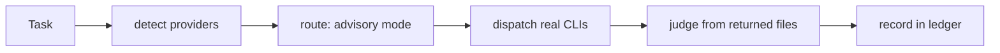

# agent-mesh

**Fusion** is a plugin for Claude Code, Codex CLI and AndrewCode that lets the model you are talking to coordinate other models: blind panels, cross-examining councils, scoped coding teams and nested swarms. Every participant is a real command-line program on your machine that Fusion starts and reads back. Fusion holds no model, no API key and no cloud service, and its Python runtime uses only the standard library (Python 3.10 or newer).

Version `3.3.0+swarm`, MIT licensed.

> **Naming.** This repository is `agent-mesh`. The plugin id, the `/fusion:*` slash commands, the Python package `fusion_swarm`, the MCP servers `fusion-coordination` and `fusion-board`, and the `FUSION_*` environment variables keep the `fusion` name.

## What you can do with it

| You want | Use | Read |
| --- | --- | --- |
| A second opinion that does not share the author's blind spots | `/fusion:panel`, `/fusion:council`, `/fusion:debate`, `/fusion:vote` | [docs/MODES.md](docs/MODES.md) |
| A scoped coding team with a chosen leadership style | `/fusion:sidekick`, `/fusion:genius-boss`, `/fusion:idiot-boss`, `/fusion:team` (16 native team forms) | [docs/CODING_TEAMS.md](docs/CODING_TEAMS.md) |
| A large, multi-subsystem mission | `/fusion:hive` (architect, captains and children on one board) and `/fusion:designer` | [docs/HIVE.md](docs/HIVE.md) |
| A coordination pattern with a call budget, a deadline and crash recovery | The 10 runtime forms, such as `/fusion:tournament`, `/fusion:refute` and `/fusion:hedge` | [docs/FORMS.md](docs/FORMS.md) |
| A shared task board for agents, with claims, leases and cursor waits | VBoard (Vercel Board compatible) and the native HiveBoard | [docs/VBOARD.md](docs/VBOARD.md), [docs/COORDINATION.md](docs/COORDINATION.md) |
| To watch a prepared run | A loopback web dashboard and a one-shot terminal snapshot | [docs/COCKPIT.md](docs/COCKPIT.md) |

The repository ships 54 command files under `commands/` and 24 skill directories under `skills/`. Claude Code and AndrewCode load both. Codex loads the skills and the MCP servers, not the command files.

## Install

You need Python 3.10 or newer with `sqlite3` and Bash. At least one host CLI (Claude Code, Codex CLI or AndrewCode) is needed for the slash commands. Provider CLIs matter only when you dispatch real work.

```bash
git clone https://github.com/andrewr303/agent-mesh.git
cd agent-mesh
bash install.sh --dry-run            # prints the plan, changes nothing
bash install.sh --hosts claude       # or codex, andrewcode; omit --hosts for all three
```

On Windows run `.\install-all.ps1`. The installer copies a slim package to an install root, verifies it, and registers it through each host's own plugin commands. Installing signs you in to nothing and makes no model calls. Per-host steps, the runtime-only install and verification are in [docs/GETTING_STARTED.md](docs/GETTING_STARTED.md). Every installer option is in [INSTALL.md](INSTALL.md). Host guides: [CODEX.md](CODEX.md) for Codex, and [KIMI.md](KIMI.md) for AndrewCode, which reads `kimi.plugin.json`.

## Quick start

These commands need no host and no model account. Run them from a checkout. The scratch state directory keeps anything they write out of `~/.fusion`.

```bash
export PYTHONPATH=python FUSION_STATE_DIR="$(mktemp -d)"

bash scripts/fusion.sh detect        # which provider CLIs are on this machine
bash scripts/fusion.sh route "refactor the auth module across every file"
```

`route` is a keyword heuristic that advises a mode and decides nothing. On one machine it printed:

```text
MODE=swarm
TASK_TYPE=code
REASON=large/parallelizable build — decompose and fan subtasks across panelists
PANEL=copilot,opencode,grok
SIGNALS=code:1 verifiable:0 deliberate:0 debate:0 large:1 graph:0 ureview:0 len:42
LEDGER=none yet
NOTE=advisory default — the Conductor may override based on task nuance + LEDGER
```

Plan a runtime form and preview a swarm without dispatching anything:

```bash
python3 -m fusion_swarm.forms plan --task "review the auth change" --providers grok,opencode,agy --kind review --verifier
bash scripts/swarm.sh hive "smoke" --dry-run --json
```

`plan` picks a form and prints its budget. The `--dry-run` hive run builds a validated SwarmSpec, seeds a board under `$FUSION_STATE_DIR/hive/<run_id>/` and starts no AndrewCode process. Inside a host, invoke the commands directly:

```text
/fusion:panel Review this auth middleware for session fixation and timing side-channels
/fusion:council Should we shard the event log by tenant_id or time_bucket?
/fusion:hive Build a webhook retry service with SQLite persistence and tests
```

## How a run works



1. **Detect.** `fusion.sh detect` probes which provider CLIs exist with `command -v`. It does not run them. The provider that matches your host is reported `host-native` and is never started as a subprocess.
2. **Route.** `fusion.sh route` offers a mode from the task's shape. The conductor, which is the host model, decides.
3. **Dispatch.** Panelists start in parallel on the same neutral prompt file. A provider that is missing, times out or fails is recorded as `absent`, `timeout` or `error`.
4. **Judge.** The host reads what came back. For code it runs the candidates and merges what it saw work. For research it writes consensus, contradictions, partial coverage, unique insights and blind spots.
5. **Record.** `ledger.sh record` appends the run so later routing advice reflects what worked.

[docs/CONCEPTS.md](docs/CONCEPTS.md) covers the vocabulary and each step in depth.

## What makes it good (and honest)

- **Real dispatch only.** The conductor never writes what a panelist "would say". A run that skipped dispatch is labelled `solo`.
- **Absent ≠ agreement.** A provider that failed, timed out or never ran does not endorse the survivors. Consensus is computed over the providers that returned.
- **The judge stays off the panel.** The host is excluded from the blind panel, and `fusion.sh dispatch` refuses to start the provider that equals the host.
- **Anti-conformity.** Council and ballot show peers anonymized as A, B and C, and a reviewer names a concrete flaw before it agrees.
- **Fail-closed validation.** An unknown field, provider or impossible count in a swarm specification is an error, never silently coerced.
- **Explicit models, no implicit fallback.** A native team uses exactly the seats and models you named. Claude is never added silently, and the `fable` provider stays off unless `FUSION_ALLOW_CLAUDE=1`.
- **Checks outrank opinion.** A passing or failing test beats any model vote.

Each rule is tied to the code or test that enforces it in [docs/CONCEPTS.md](docs/CONCEPTS.md#honesty-invariants). A few are guarded only by a prose grep in `tests/validate.sh`. The page says which.

## Configuration

Fusion works without a configuration file: it discovers the CLIs on your `PATH`. State lives in plain files and SQLite under `~/.fusion`, and the core flow needs no daemon. `config/defaults.env` activates 26 model, effort and limit keys and ships the other 93, including the per-mode model overrides, commented out. The variables you are most likely to need:

| Variable | Effect |
| --- | --- |
| `FUSION_HOST` | Which harness you are in, matched against provider names. The bash scripts default to `codex`. Set it to `claude`, `kimi` or `andrewcode` when you run them from one of those hosts. |
| `FUSION_STATE_DIR` | Ledger, hive boards and UltraSwarm state. Default `~/.fusion`. |
| `FUSION_HOME` | Runtime form runs, journals and the reliability ledger. Also defaults to `~/.fusion`. |
| `FUSION_BOARD` | HiveBoard database path. |
| `FUSION_ALLOW_CLAUDE=1` | Enables the `fable` provider, which is off by default. |
| `FUSION_ALLOW_CODEX_EXEC=1` | Lets the `codex` binary run on a non-Codex host. Otherwise the codex seat goes through AndrewCode. |
| `FUSION_ANDREWCODE_ENTRY` | Path to the AndrewCode Node entry script. |
| `FUSION_DASHBOARD_PORT` | Preferred dashboard port. Default `8765`. |

The full list, defaults and the file each one is read from are in [docs/CONFIGURATION.md](docs/CONFIGURATION.md).

## Layout

```text
agent-mesh/
├── plugin.json, .claude-plugin/, .codex-plugin/, .kimi-plugin/, kimi.plugin.json   host manifests
├── .mcp.json, mcp.json        MCP servers: fusion-coordination, fusion-board
├── commands/                  54 /fusion:* command files
├── skills/                    24 skill directories the hosts load
├── python/fusion_swarm/       stdlib-only engine
│   │                          identities.py · board.py · spawn.py · designer.py · hive.py · hive_prompts.py
│   ├── forms/                 the 10 runtime forms, planner, journal, salvage
│   ├── vboard/                Vercel-Board-compatible board: engines, CLI, HTTP, MCP
│   └── peers/                 peer calls, ACP sessions, durable handoff, Codex policy
├── scripts/                   fusion.sh, swarm.sh, route.sh, ureview.sh, dashboard, installers
│   └── providers/             one adapter per provider, plus detect.sh
├── mcps/                      launchers for the two MCP servers
├── config/defaults.env        shipped defaults, per-mode overrides commented out
├── docs/                      documentation index in docs/README.md
├── tests/                     validate.sh and unittest modules such as test_hive_docs.py
└── ultracode/                 vendored UltraCode-Shim (MIT, OnlyTerp)
```

The module-by-module map is in [docs/ARCHITECTURE.md](docs/ARCHITECTURE.md).

## Documentation

| Goal | Page |
| --- | --- |
| Install and verify | [docs/GETTING_STARTED.md](docs/GETTING_STARTED.md), [INSTALL.md](INSTALL.md) |
| Understand the model | [docs/CONCEPTS.md](docs/CONCEPTS.md), [docs/ARCHITECTURE.md](docs/ARCHITECTURE.md) |
| Pick a command | [docs/MODES.md](docs/MODES.md), [docs/SKILLS.md](docs/SKILLS.md) |
| Look up a flag or entry point | [docs/CLI.md](docs/CLI.md), [docs/CONFIGURATION.md](docs/CONFIGURATION.md) |
| Run budgeted, recoverable patterns | [docs/FORMS.md](docs/FORMS.md), [docs/SWARM_RUNTIME.md](docs/SWARM_RUNTIME.md) |
| Build coding teams and Hive swarms | [docs/CODING_TEAMS.md](docs/CODING_TEAMS.md), [docs/HIVE.md](docs/HIVE.md), [docs/METALOOP.md](docs/METALOOP.md) |
| Integrate the boards, providers and peers | [docs/VBOARD.md](docs/VBOARD.md), [docs/COORDINATION.md](docs/COORDINATION.md), [docs/PEERS.md](docs/PEERS.md) |
| Observe a run | [docs/COCKPIT.md](docs/COCKPIT.md) |
| Fix a problem | [docs/TROUBLESHOOTING.md](docs/TROUBLESHOOTING.md) |
| Change the plugin | [CONTRIBUTING.md](CONTRIBUTING.md) |

The full index, including the historical validation records, is [docs/README.md](docs/README.md).

## Testing

Everything runs offline and calls no provider.

```bash
bash tests/validate.sh
PYTHONPATH=python python3 -m unittest discover -s tests
```

`validate.sh` checks structure, manifests, skill and command frontmatter and a set of prose invariants. Some tests need an AndrewCode Node entry and fail without one. [CONTRIBUTING.md](CONTRIBUTING.md#run-the-tests) lists the layers, the last full run and the known environment-dependent failures. `tests/smoke-providers.sh` is different: it sends a real prompt to each available provider and spends tokens.

## Credit

Fusion builds on published research and open-source projects. Module-by-module provenance is in [docs/CREDITS.md](docs/CREDITS.md) and [docs/RESEARCH.md](docs/RESEARCH.md). The headline sources:

- Multi-model deliberation and the sidekick loop: OpenRouter's Fusion write-ups, Cognition's Fusion in Devin, and [karpathy/llm-council](https://github.com/karpathy/llm-council).
- Swarm topologies such as mixture-of-agents and group chat: [kyegomez/swarms](https://github.com/kyegomez/swarms), re-implemented on local CLI subprocesses.
- Host-neutral manifests and the nested AndrewCode runtime follow AndrewAgent (`CODEX.md`, `KIMI.md`, `kimi.plugin.json`).
- `ultracode/` is [UltraCode-Shim](https://github.com/OnlyTerp/UltraCode-Shim) by OnlyTerp, vendored under its own MIT license.

## License

MIT licensed. See [LICENSE](LICENSE). `ultracode/` carries its own MIT license in `ultracode/LICENSE`.
