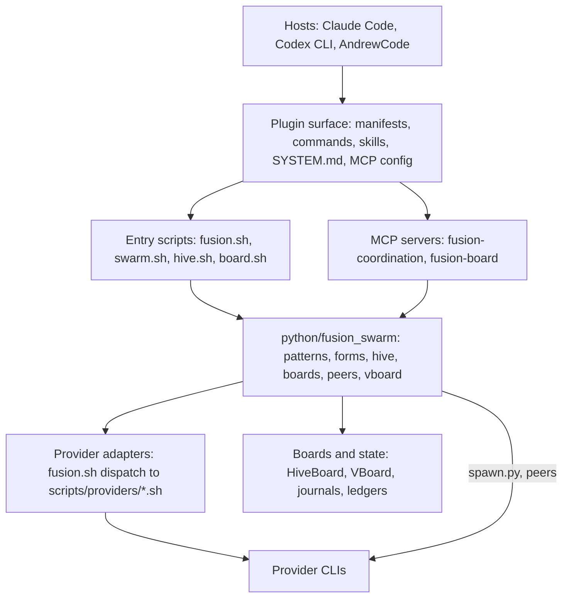
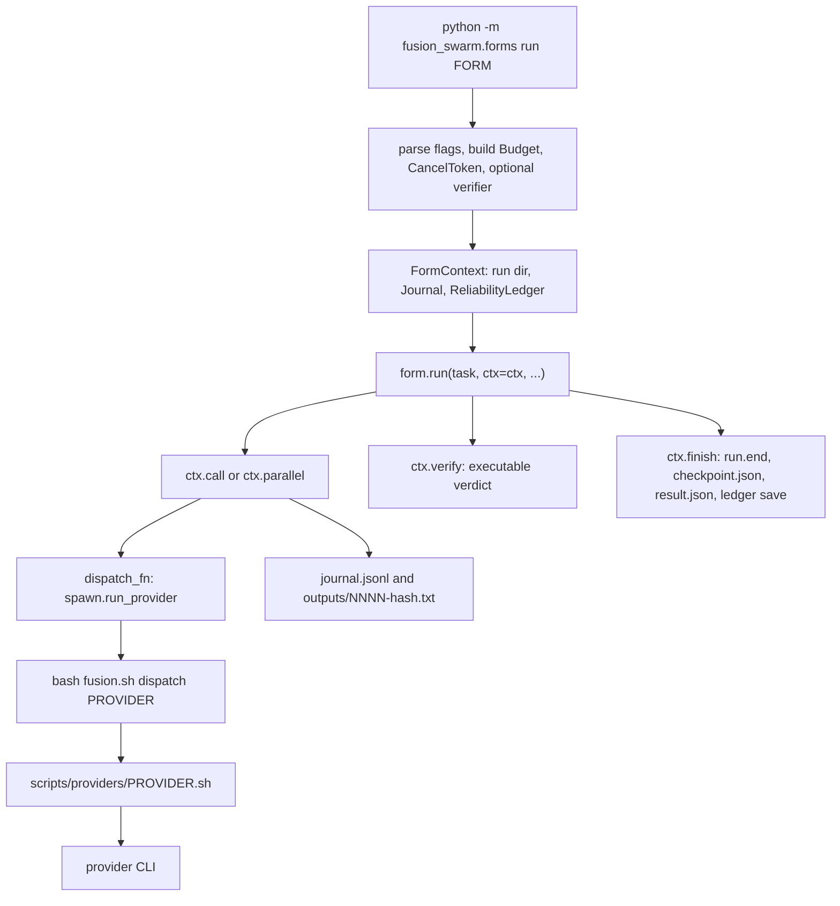
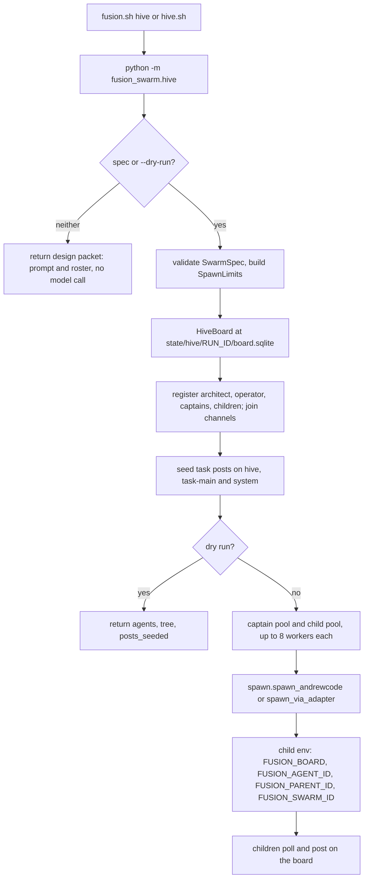
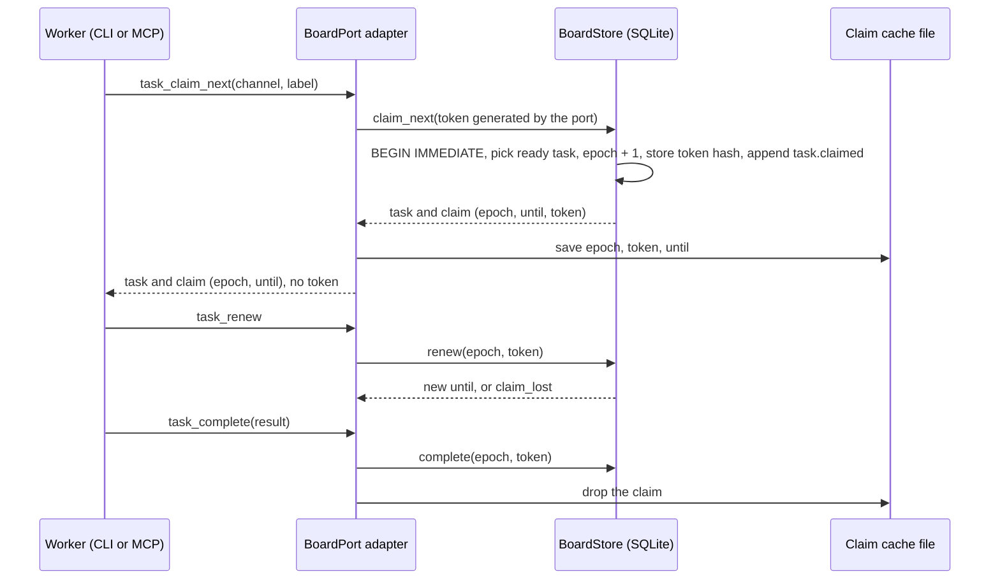

# Architecture

This page explains how the Fusion plugin is built: which layers exist, what each module under `python/fusion_swarm/` does, and how three representative runs move through the code (a runtime form, a Hive swarm and a board claim). Read it if you are changing the code, writing an integration, or trying to work out which layer owns a behavior.

The repository is named `agent-swarm-fusion`. The plugin id, slash commands (`/fusion:*`), Python package (`fusion_swarm`), MCP servers (`fusion-coordination`, `fusion-board`) and environment variables (`FUSION_*`) keep the `fusion` name. The version is `3.3.0+swarm` (`plugin.json`, `.claude-plugin/plugin.json`, `scripts/fusion.sh`).

For the mental model and vocabulary read [CONCEPTS.md](CONCEPTS.md) first. For the command catalog read [MODES.md](MODES.md).

## Layers



The host loads the plugin surface. A command or skill tells the host which script or MCP tool to call. Scripts and MCP servers enter the `fusion_swarm` package. The package reaches provider CLIs through bash adapters (the common path) or directly (nested AndrewCode workers and the peer transports). Everything durable ends up on a board, a journal or a ledger.

| Layer | What lives there | Source |
| --- | --- | --- |
| Hosts | Claude Code, Codex CLI, and Kimi Code or AndrewCode (which share the Kimi manifest). Each has its own manifest. | [`.claude-plugin/`](../.claude-plugin/plugin.json), [`.codex-plugin/`](../.codex-plugin/plugin.json), [`.kimi-plugin/`](../.kimi-plugin/plugin.json) |
| Plugin surface | `commands/*.md` (54 files), `skills/` (24 directories), `SYSTEM.md` for AndrewCode, `.mcp.json` and `mcp.json` | [`commands/`](../commands), [`skills/`](../skills), [`SYSTEM.md`](../SYSTEM.md) |
| Entry scripts | Bash wrappers that set `PYTHONPATH` and run a Python module, plus the deterministic bash verbs | [`scripts/`](../scripts) |
| MCP servers | Thin launchers that import `fusion_swarm.mcp_server` and `fusion_swarm.vboard.mcp` | [`mcps/fusion-coordination/server.py`](../mcps/fusion-coordination/server.py), [`mcps/fusion-board/server.py`](../mcps/fusion-board/server.py) |
| Engine | The stdlib-only `fusion_swarm` package | [`python/fusion_swarm/`](../python/fusion_swarm) |
| Adapters | One bash script per provider CLI, plus shared helpers | [`scripts/providers/`](../scripts/providers) |
| State | SQLite boards, JSONL journals, JSON ledgers | [CONFIGURATION.md](CONFIGURATION.md#state-layout) |

Each manifest declares different things. `.codex-plugin/plugin.json` points at `./skills/` and `./.mcp.json`. `.kimi-plugin/plugin.json` points at `./skills/`, `./commands/` and `./SYSTEM.md`. `.claude-plugin/plugin.json` declares only identity metadata. Per-host install steps are in [GETTING_STARTED.md](GETTING_STARTED.md).

### What each layer decides

Commands and skills are prompts. A file in `commands/` names a skill and the script to run, and the host model follows it (see `commands/moa.md` and `commands/refute.md`). The header of [`scripts/fusion.sh`](../scripts/fusion.sh) states the split: the script moves bytes and keeps books, and the orchestrating model reasons, judges and synthesizes.

The slash-command catalog is derived, not hand-kept. [`modes_catalog.py`](../python/fusion_swarm/modes_catalog.py) parses the frontmatter of every `commands/*.md`. `modes_catalog.all_modes()` returns 54 entries and `modes_catalog.RUNTIME_FORM_COMMANDS` maps 10 commands to runtime forms.

### Two entry points named "forms"

The word "forms" names two different things, and they have different entry points.

| Entry point | Lists | Source |
| --- | --- | --- |
| `python -m fusion_swarm forms` | The 16 native team forms (`sidekick`, `genius-boss`, `idiot-boss`, `dag`, `pipeline`, ... `council`) from `team.forms()` | [`__main__.py`](../python/fusion_swarm/__main__.py), [`team.py`](../python/fusion_swarm/team.py) |
| `python -m fusion_swarm.forms list` | The 10 executable runtime forms (`refute_panel`, `tournament`, ... `blackboard`) | [`forms/__init__.py`](../python/fusion_swarm/forms/__init__.py) |

Native team forms compile into plans that the host's own workers execute ([CODING_TEAMS.md](CODING_TEAMS.md)). Runtime forms dispatch provider calls themselves ([FORMS.md](FORMS.md)). The six `workflows` in `plugin.json` are `strategies.WORKFLOWS` (feature-delivery, reproduce-build-verify, migration-waves, contract-first-api, review-and-revise, ci-repair), not slash commands and not runtime forms.

`tournament` also names two pieces of code. `python -m fusion_swarm tournament` runs the older race-based engine in [`race.py`](../python/fusion_swarm/race.py). The `/fusion:tournament` command runs the runtime form. `commands/tournament.md` says the older engine "remains available as a separate pattern".

### Provider dispatch paths

There are three ways a provider CLI gets launched, and they enforce different things.

| Path | Used by | What it does |
| --- | --- | --- |
| Bash adapter | Panel patterns (`moa`, `heavy`, ...) through `adapter.dispatch`, runtime forms through `spawn.run_provider` | `bash fusion.sh dispatch <provider> <prompt-file> <out-file> [model] [effort] [workspace]` runs `scripts/providers/<provider>.sh` and returns its exit code. `adapter.dispatch` and `fusion.sh panel` map 0 to `returned`, 124 to `timeout`, 127 to `absent` and anything else to `error` |
| Direct spawn | Hive captains and children | `spawn.spawn_andrewcode` builds a Node argv for the AndrewCode entry and injects the board identity into the child environment. `spawn.spawn_via_adapter` handles captains that are not AndrewCode |
| Peer transports | `peers` CLI, `pair_swap` form (default dispatch), VBoard handoffs | `peers.exec_json` (one-shot `claude -p`, AndrewCode, `codex exec`, `opencode run`), `peers.acp` (ACP v1 over stdio), both gated by `peers.policy` |

When `FUSION_ANDREWCODE_SELECTION` is set, `adapter.dispatch` stops using the bash adapters. `adapter._dispatch_selected` sends every seat through `andrewcode_cli.run_isolated` with the selected model and effort, and refuses an invalid selection ([`model_selection.py`](../python/fusion_swarm/model_selection.py)). Provider detail is in [PEERS.md](PEERS.md).

The adapters in `scripts/providers/` cover `codex`, `copilot`, `opencode`, `grok`, `kimi`, `andrewcode`, `agy` and `fable`. `fusion.sh` maps exactly those names in `adapter_for`. There is no `gemini`, `ollama` or `local` adapter. Claude is reached only through the peer layer (`claude -p` in `peers.exec_json`, `claude-agent-acp` in `peers.acp`) and `fable.sh`, and all of them are gated: a Claude spawn needs a codex host or `FUSION_ALLOW_CLAUDE=1`.

### Host detection differs by layer

The bash scripts and the Python package resolve the host differently.

| Layer | Rule | Source |
| --- | --- | --- |
| `fusion.sh`, `route.sh`, `providers/detect.sh` | `FUSION_HOST` defaults to `codex` and Claude markers are ignored | [`fusion.sh`](../scripts/fusion.sh), [`route.sh`](../scripts/route.sh), [`detect.sh`](../scripts/providers/detect.sh) |
| `ureview.sh` | `FUSION_HOST` defaults to `claude` | [`ureview.sh`](../scripts/ureview.sh) |
| Python (`peers.policy.detect_host`, `adapter._resolve_host`) | `CLAUDECODE=1` or `CLAUDE_CODE_ENTRYPOINT` resolves to `claude` when `FUSION_HOST` is unset or `codex`, unless `FUSION_HOST_EXPLICIT=1`. Another declared host (for example `andrewcode`) is kept | [`peers/policy.py`](../python/fusion_swarm/peers/policy.py), [`adapter.py`](../python/fusion_swarm/adapter.py) |

`spawn.run_provider` writes the Python-resolved host into `FUSION_HOST` before it launches `fusion.sh`, so Python-initiated dispatch is consistent. A bash verb run directly on a Claude host treats `codex` as host-native unless you export `FUSION_HOST`.

## Rules the code enforces

| Rule | Where it is enforced |
| --- | --- |
| Real subprocess dispatch only. Tests inject runners or fake dispatchers. | `adapter.dispatch`, `spawn.run_provider`, `spawn.spawn_andrewcode(runner=...)`, `forms` fake dispatch gated by `FUSION_TEST_HOOKS=1` |
| Absent is not agreement. A missing or timed-out provider is a status, not a vote. | `adapter.returning` keeps only replies that returned text. Exit codes map to `returned`, `timeout`, `absent`. `fusion.sh panel` writes one line per provider into `manifest.txt`: `<provider>:<status>:<seconds>`, or `<provider>:host-native` and `<provider>:unknown` without a timing |
| The host is never launched recursively. | `fusion.sh dispatch` returns exit 3 when the provider equals `FUSION_HOST` |
| The `codex` binary runs only behind a gate. | `peers.policy.codex_exec_allowed` (`FUSION_ALLOW_CODEX_EXEC=1` or a codex host) and `assert_exec_allowed` |
| Fail-closed spawn limits. | `identities.SpawnLimits.can_spawn`, enforced by `hive.run` before registering each agent and by `spawn._enforce_limits` |
| Fail-closed topology specs. | `hive._validate_spec` raises `HiveError("invalid SwarmSpec: ...")`. `designer.py` rejects unknown fields and providers |
| No third-party Python dependencies. | A scan of every import in `python/`, `scripts/*.py` and `mcps/` finds only stdlib and in-repo modules. The installer asserts Python 3.10 or newer (`scripts/fusion_install.py`) |
| No hidden model probes. | The docstrings of `supervision.py` ("no hidden model probes") and `control.py` ("no model calls") state it. `controller.py` discovers no tools and selects no models |
| Scope checks are cooperative, not a sandbox. | `scope.py` docstring. `spawn.py` states AndrewCode workers are not sandboxed, tools-disabled or ephemeral |

`peers/acp.py` documents Python 3.11 or newer for the ACP client while the installer guard is 3.10. Treat 3.11 as the safe floor if you use ACP.

## Module map

`python/fusion_swarm/` holds 63 top-level modules and three subpackages: `forms/` (16 modules), `peers/` (5) and `vboard/` (9). That is 93 modules, not counting each package's `__init__.py` and `__main__.py`. Every name below links to its file. Each description comes from the module's docstring and code.

To re-check the list and the first docstring line of every module:

```bash
python3 -B -c '
import ast, pathlib
root = pathlib.Path("python/fusion_swarm")
for p in sorted(root.rglob("*.py")):
    doc = ast.get_docstring(ast.parse(p.read_text(encoding="utf-8"))) or "(no docstring)"
    print(p.relative_to(root), "|", doc.splitlines()[0][:70])
'
```

### Package entry points

| Module | Role |
| --- | --- |
| [`__init__.py`](../python/fusion_swarm/__init__.py) | Package docstring. Imports the pattern modules eagerly |
| [`__main__.py`](../python/fusion_swarm/__main__.py) | `python -m fusion_swarm <pattern>`: one argparse parser, routes to every pattern, team plan, race, harden, evolve, `ledger-moe` and `tui` |
| [`modes_catalog.py`](../python/fusion_swarm/modes_catalog.py) | Builds the mode catalog from `commands/*.md`. Also holds `PROVIDER_NAMES`, `BASE_PANEL`, `ENGINE_PATTERN_PROVIDERS`, `RUNTIME_FORM_COMMANDS` |
| [`mode_roster.py`](../python/fusion_swarm/mode_roster.py) | Resolves each mode's roster and the effective model and effort, for the dashboard |
| [`config_store.py`](../python/fusion_swarm/config_store.py) | Safe read and write of `config/defaults.env`. Only keys already in the file are editable |
| [`discovery.py`](../python/fusion_swarm/discovery.py) | Live model discovery per provider CLI with a per-probe timeout (`FUSION_DISCOVERY_PROBE_TIMEOUT`, default 10 s) |

### Provider dispatch and process control

| Module | Role |
| --- | --- |
| [`adapter.py`](../python/fusion_swarm/adapter.py) | Bridge from patterns to `fusion.sh dispatch`: `dispatch`, `panel`, `available`, `returning`, `record_run`. Resolves host, per-mode model and effort |
| [`model_selection.py`](../python/fusion_swarm/model_selection.py) | Parses and validates `FUSION_ANDREWCODE_SELECTION` into `selected-N` seats with exact model and effort |
| [`andrewcode_cli.py`](../python/fusion_swarm/andrewcode_cli.py) | AndrewCode transport contracts: entry path, argv construction, `run_isolated` for consult seats. No standalone Codex fallback |
| [`cli_progress.py`](../python/fusion_swarm/cli_progress.py) | Forwards bounded chat messages from a CLI stream as framed `FUSION_CHAT_V1` packets |
| [`spawn.py`](../python/fusion_swarm/spawn.py) | The spawn path for nested workers (`spawn_andrewcode`, `spawn_via_adapter`) and `run_provider`, the cancel-aware dispatcher that runtime forms use |
| [`process_runtime.py`](../python/fusion_swarm/process_runtime.py) | Owned process supervision: durable identity, output capture, process-group termination (`terminate_process_group`), Windows job objects |
| [`host_runtime.py`](../python/fusion_swarm/host_runtime.py) | Host adapter contracts (`CodexRuntime`, `AndrewCodeRuntime`, `ClaudeCodeRuntime`). Native tools are injected, never guessed |
| [`identities.py`](../python/fusion_swarm/identities.py) | `AgentIdentity` and `SpawnLimits` (depth, children per agent, total agents) |

### Panel patterns and verification

| Module | Role |
| --- | --- |
| [`moa.py`](../python/fusion_swarm/moa.py) | Layered Mixture-of-Agents over the panel |
| [`heavy.py`](../python/fusion_swarm/heavy.py) | Four role-specialized sub-questions (research, analysis, alternatives, verification), then synthesis |
| [`discuss.py`](../python/fusion_swarm/discuss.py) | Multi-round group discussion over the panel |
| [`flow.py`](../python/fusion_swarm/flow.py) | Flow DSL: stages in sequence, panelists inside a stage in parallel (`"codex -> copilot, opencode"`) |
| [`refine.py`](../python/fusion_swarm/refine.py) | Generator, evaluator, revise loop until a score threshold or the round cap |
| [`bestof.py`](../python/fusion_swarm/bestof.py) | Best-of-N from one provider, folded with a rolling champion |
| [`reasoning.py`](../python/fusion_swarm/reasoning.py) | Single-panelist techniques: `reflexion`, `self_consistency`, `gkp` |
| [`ballot.py`](../python/fusion_swarm/ballot.py) | Blind, anonymized approval voting with self-votes barred. Ties go to the gate |
| [`ladder.py`](../python/fusion_swarm/ladder.py) | Escalation ladder: cheapest tier first, escalate on gate failure |
| [`speclock.py`](../python/fusion_swarm/speclock.py) | Contract first, then parallel module cells against it |
| [`builder_breaker.py`](../python/fusion_swarm/builder_breaker.py) | Builder versus breaker loop where the test command arbitrates |
| [`gate.py`](../python/fusion_swarm/gate.py) | Runs a real verification command (`run_gate`) and detects a default one |
| [`modifiers.py`](../python/fusion_swarm/modifiers.py) | Mix-ins: `anonymize`, `parse_votes`, `tally`, `parse_confidence`, `decision_baton` |
| [`synth.py`](../python/fusion_swarm/synth.py) | Aggregator selection and CLI synthesis helpers for standalone patterns |
| [`hierarchical.py`](../python/fusion_swarm/hierarchical.py) | Supervisor and worker orchestration with an inbox and context isolation |
| [`graph.py`](../python/fusion_swarm/graph.py) | Typed-node DAG engine with dataflow scheduling (a node runs when its own dependencies resolve) |
| [`kgraph.py`](../python/fusion_swarm/kgraph.py) | Knowledge-graph store with typed edges, kept as line-oriented JSON under `~/.fusion/graph/<name>/` (`FUSION_GRAPH_HOME`) |

### MetaLoop

| Module | Role |
| --- | --- |
| [`metaloop.py`](../python/fusion_swarm/metaloop.py) | Run-state machine and dispatch engine, including `dispatch_streaming_dag`. See [METALOOP.md](METALOOP.md) |
| [`contracts.py`](../python/fusion_swarm/contracts.py) | Typed, validated handoff objects: `TaskSpec`, `WorkerResult`, `AdvisorMemo`, `GateResult`, `SteeringAction` and others. No `jsonschema` dependency. Mirror schema: [`metaloop.schema.json`](metaloop.schema.json) |
| [`policy.py`](../python/fusion_swarm/policy.py) | Routing policy for a `TaskSpec`. Hard overrides are matched first, as case-insensitive substrings |
| [`workspaces.py`](../python/fusion_swarm/workspaces.py) | Workspace modes `proposal` (default), `worktree` and `clone`. The last two need an explicit `repo_root` and `authorized=True` |
| [`scope.py`](../python/fusion_swarm/scope.py) | Observed workspace baselines, scope checks, APFS clone provisioning, merge-tree preflight. Cooperative, not a sandbox |

### Hive and nested swarms

| Module | Role |
| --- | --- |
| [`hive.py`](../python/fusion_swarm/hive.py) | Hive orchestrator: builds the board, registers architect, operator, captains and children, then spawns them. `--dry-run` never launches a process. See [HIVE.md](HIVE.md) |
| [`hive_prompts.py`](../python/fusion_swarm/hive_prompts.py) | Prompt templates for architect, captains and children. Return strings only |
| [`designer.py`](../python/fusion_swarm/designer.py) | 36 named topologies, the fail-closed `SwarmSpec` and the architect's design prompt. Never dispatches |
| [`factory.py`](../python/fusion_swarm/factory.py) | Discover, define, develop, deliver alias of the Hive |
| [`lanes.py`](../python/fusion_swarm/lanes.py) | MetaLoop inboxes and workcards wrapped around the HiveBoard. State under `~/.fusion/hive/<session_id>` |
| [`steering.py`](../python/fusion_swarm/steering.py) | Attach to, interrupt and redirect running workers |
| [`agency_context.py`](../python/fusion_swarm/agency_context.py) | Flat shared key-value context (`MasterContext`) for tools and agents |
| [`memory_service.py`](../python/fusion_swarm/memory_service.py) | Persistent agent memory: store, recall, forget, with markdown content and a JSON index. Root: `FUSION_MEMORY_ROOT` |

### HiveBoard and coordination

| Module | Role |
| --- | --- |
| [`board.py`](../python/fusion_swarm/board.py) | `HiveBoard`: SQLite WAL board plus a `.jsonl` sidecar and a `.wakeup` counter. Also the `python -m fusion_swarm.board` CLI |
| [`mailbox.py`](../python/fusion_swarm/mailbox.py) | `MailboxMixin`: durable deliveries, leases, claim tokens, nack, receipts, idempotent sends |
| [`protocol.py`](../python/fusion_swarm/protocol.py) | `ProtocolMixin`: versioned message envelopes, delivery policies and deadlines, effect receipts, readiness |
| [`coordination.py`](../python/fusion_swarm/coordination.py) | `CoordinationMixin`: path reservations, shared context, reviewed task handoffs |
| [`execution.py`](../python/fusion_swarm/execution.py) | `ExecutionMixin`: durable dispatch outbox and observed execution. A lost dispatch reply is uncertain, never a reason to relaunch |
| [`candidates.py`](../python/fusion_swarm/candidates.py) | `CandidateMixin`: read-only reviews bound to the exact submitted artifact version |
| [`knowledge.py`](../python/fusion_swarm/knowledge.py) | `KnowledgeMixin`: project knowledge promoted from accepted work, with FTS search. Evidence, never instructions |
| [`comms.py`](../python/fusion_swarm/comms.py) | Resolves the board path: `FUSION_BOARD` if set, else `<cwd>/.andrewcode/comms/board.sqlite` |
| [`mcp_server.py`](../python/fusion_swarm/mcp_server.py) | The `fusion-coordination` stdio MCP server (51 tools) over a `HiveBoard` |
| [`control.py`](../python/fusion_swarm/control.py) | JSON control API over the same MCP methods. No model calls |
| [`controller.py`](../python/fusion_swarm/controller.py) | `ExecutionController`: binds the outbox to an explicitly supplied runtime. Discovers nothing |
| [`supervise.py`](../python/fusion_swarm/supervise.py) | CLI: `status`, `trace`, `export`, `doctor` for a prepared run (no docstring) |
| [`supervision.py`](../python/fusion_swarm/supervision.py) | Persisted operator views, redaction and evidence export, and the `doctor` host check |

`HiveBoard` is one class built from six mixins: `MailboxMixin`, `CoordinationMixin`, `ProtocolMixin`, `ExecutionMixin`, `CandidateMixin`, `KnowledgeMixin`. A board created by a dry-run Hive contains tables such as `messages`, `deliveries`, `work_items`, `runtime_jobs`, `candidates`, `knowledge_entries` and `stigmergy_traces`, plus the FTS shadow tables for knowledge search. Protocol detail is in [COORDINATION.md](COORDINATION.md).

### Native coding teams

| Module | Role |
| --- | --- |
| [`team.py`](../python/fusion_swarm/team.py) | Compiles the 16 team forms into validated handoffs. Planning is offline. `--prepare` persists tasks on a board. Execution stays with the host's native workers |
| [`strategies.py`](../python/fusion_swarm/strategies.py) | Versioned strategies and the six behavioral workflows (`WORKFLOWS`). Has its own CLI |
| [`sidekick.py`](../python/fusion_swarm/sidekick.py) | `TaskBrief`, `WorkerReport`, `scoped_path`. Compact, validated briefs and reports. No model is called |

### Race, hardening, evolution and routing hints

These modules have no slash command. They are reached through `python -m fusion_swarm` or `scripts/fusion.sh`.

| Module | Role |
| --- | --- |
| [`race.py`](../python/fusion_swarm/race.py) | `race`, `speculate`, `tournament` modes: parallel candidates in isolated clones, a four-stage check, first qualified passer wins |
| [`harden.py`](../python/fusion_swarm/harden.py) | Alternating builder and hardener waves with rollback when the gate regresses |
| [`evolve.py`](../python/fusion_swarm/evolve.py) | MAP-Elites archive across islands with ring migration (`evolve`, `island-evolve`) |
| [`ledger_moe.py`](../python/fusion_swarm/ledger_moe.py) | Wilson lower-bound provider ranking from a `runs.jsonl` file. Advisory only |
| [`tui.py`](../python/fusion_swarm/tui.py) | Terminal snapshot of a board, traces and git diff, with optional tmux layout |

### `forms/` runtime forms

| Module | Role |
| --- | --- |
| [`forms/__init__.py`](../python/fusion_swarm/forms/__init__.py) | Registry: `FORMS`, `ALIASES`, `resolve`, `get_form`, `list_forms`. Forms import lazily |
| [`forms/__main__.py`](../python/fusion_swarm/forms/__main__.py) | JSON CLI: `list`, `plan`, `run`, `salvage`, `ledger`, `capacity` |
| [`forms/runtime.py`](../python/fusion_swarm/forms/runtime.py) | `FormContext`, `Budget`, `CancelToken`, `CommandVerifier`, call and parallel API |
| [`forms/journal.py`](../python/fusion_swarm/forms/journal.py) | Append-only JSONL journal, atomic checkpoint and `salvage` |
| [`forms/ledger.py`](../python/fusion_swarm/forms/ledger.py) | Reliability ledger: Beta posteriors per worker, task class and role. Records only verified outcomes |
| [`forms/capacity.py`](../python/fusion_swarm/forms/capacity.py) | Width and captain sizing, hedge budget, tail-latency helpers |
| [`forms/planner.py`](../python/fusion_swarm/forms/planner.py) | `classify`, `choose` and `ladder`: pick a form and size it, without a model call |
| [`forms/collab.py`](../python/fusion_swarm/forms/collab.py) | Stall detector, progress ledger and opt-in acknowledgement deadlines over a `BoardPort` |
| [`forms/refute_panel.py`](../python/fusion_swarm/forms/refute_panel.py) | Authors propose, refuters try to falsify, an empirical gate decides |
| [`forms/tournament.py`](../python/fusion_swarm/forms/tournament.py) | Seeded single-elimination bracket. Execution beats judgment |
| [`forms/hedged_race.py`](../python/fusion_swarm/forms/hedged_race.py) | Primary first, a backup after the hedge deadline, first verified result wins |
| [`forms/mapreduce.py`](../python/fusion_swarm/forms/mapreduce.py) | Disjoint shards to mappers, with backup tasks for stragglers, then one reducer |
| [`forms/critic_repair.py`](../python/fusion_swarm/forms/critic_repair.py) | Writer drafts, independent critic reviews, writer repairs, verifier arbitrates |
| [`forms/pair_swap.py`](../python/fusion_swarm/forms/pair_swap.py) | Cross-provider pair programming with direction chosen from ledger stats |
| [`forms/delphi.py`](../python/fusion_swarm/forms/delphi.py) | Blind round 0, a code facilitator, bounded revision rounds, a final statistic and a dissent log |
| [`forms/auction.py`](../python/fusion_swarm/forms/auction.py) | Awards each task from the ledger, never from self-reported bids |
| [`forms/loop_until_dry.py`](../python/fusion_swarm/forms/loop_until_dry.py) | Keeps sampling finders until N consecutive rounds yield nothing new |
| [`forms/blackboard.py`](../python/fusion_swarm/forms/blackboard.py) | Typed shared entries and a deterministic rule table choose the next role |

Form behavior, flags and budgets are in [FORMS.md](FORMS.md).

### `peers/` peer layer

| Module | Role |
| --- | --- |
| [`peers/__init__.py`](../python/fusion_swarm/peers/__init__.py) | Re-exports the policy (`route`, `detect_host`, `codex_exec_allowed`), identity (`resolve_name`, `child_env`) and `exec_json` (`PeerRequest`, `PeerResult`, `as_dispatch_fn`, `run`, `parse`) names |
| [`peers/__main__.py`](../python/fusion_swarm/peers/__main__.py) | `python -m fusion_swarm.peers`: `policy`, `route`, `ask`, `acp`, `handoff`, `whoami`. JSON on stdout |
| [`peers/policy.py`](../python/fusion_swarm/peers/policy.py) | Host detection, `route()` to a transport, and the `codex` execution gate |
| [`peers/identity.py`](../python/fusion_swarm/peers/identity.py) | One board and agent identity everywhere: `resolve_name`, `worker_name`, `child_env` |
| [`peers/exec_json.py`](../python/fusion_swarm/peers/exec_json.py) | One-shot structured adapters and output parsers for `claude -p`, AndrewCode, `codex exec`, `opencode run` |
| [`peers/acp.py`](../python/fusion_swarm/peers/acp.py) | ACP v1 JSON-RPC client over stdio, policy-enforced `connect()` and `ask()` |
| [`peers/handoff.py`](../python/fusion_swarm/peers/handoff.py) | Durable handoff as a board task labelled `fusion.handoff=1`. Success is reported only after the board accepts completion |

Peer transports and policy are in [PEERS.md](PEERS.md).

### `vboard/` Vercel-Board-compatible board

| Module | Role |
| --- | --- |
| [`vboard/__init__.py`](../python/fusion_swarm/vboard/__init__.py) | Imports only the data core. Other modules load lazily |
| [`vboard/__main__.py`](../python/fusion_swarm/vboard/__main__.py) | `python -m fusion_swarm.vboard` entry point |
| [`vboard/model.py`](../python/fusion_swarm/vboard/model.py) | Constants, error codes, caller identity, validators, view builders |
| [`vboard/store.py`](../python/fusion_swarm/vboard/store.py) | `BoardStore`: SQLite board with an append-only event log as the authority |
| [`vboard/port.py`](../python/fusion_swarm/vboard/port.py) | `BoardPort` and three adapters: `LocalEngineAdapter`, `HttpBoardAdapter`, `VercelCliAdapter`. Also `open_port` |
| [`vboard/claims.py`](../python/fusion_swarm/vboard/claims.py) | Claim cache shared with the stock `vercel board` CLI |
| [`vboard/engine.py`](../python/fusion_swarm/vboard/engine.py) | Finds, starts and stops a `vb` engine, and picks a board (`open_board`) |
| [`vboard/http.py`](../python/fusion_swarm/vboard/http.py) | Loopback HTTP server for the board protocol, with long-poll and SSE |
| [`vboard/cli.py`](../python/fusion_swarm/vboard/cli.py) | `vercel board`-compatible CLI over `BoardStore` |
| [`vboard/mcp.py`](../python/fusion_swarm/vboard/mcp.py) | The `fusion-board` stdio MCP server (24 tools), one port per identity |
| [`vboard/conformance.py`](../python/fusion_swarm/vboard/conformance.py) | Portable conformance suite for any `BoardPort` |

Board engines, CLI and tools are in [VBOARD.md](VBOARD.md).

## Data flows

### A runtime form run



1. `forms/__main__.py` parses the flags and builds a `Budget` (calls, tokens, wall deadline), a `CancelToken` and, if `--gate-cmd` was given, a `CommandVerifier`. It installs SIGINT and SIGTERM handlers that cancel the token.
2. `FormContext` creates the run directory `<FUSION_HOME>/forms/runs/<run_id>/` (or `--run-dir`, which must be empty), opens the journal and writes `run.start`. A timer cancels the token when the wall deadline passes.
3. The form calls `ctx.call` or `ctx.parallel`. Each call reserves budget first, then runs the dispatch function with the call's timeout capped by the time left. The default dispatch function is `spawn.run_provider`, which launches `bash fusion.sh dispatch ...` in its own process group. The exception is `pair_swap`, which routes through `peers.exec_json` when no dispatch function is set.
4. `run_provider` polls every 0.1 s. On cancel or timeout it terminates the whole process group and reports `cancelled` (exit 130) or `timeout` (exit 124). It never raises for provider failure.
5. Each call writes `call.start` and `call.end` records, and the output goes to `outputs/<index>-<sha256 of key>.txt`. `ctx.parallel` can cancel the losing calls once `first_k` results are accepted.
6. `ctx.finish` writes `run.end`, a final checkpoint and `result.json`, then saves the ledger if it changed.
7. `forms salvage <run-dir>` replays the journal later. Semantics are in [FORMS.md](FORMS.md).

A real run of `critic-repair` against the fixture dispatcher (`FUSION_TEST_HOOKS=1` and `FUSION_FORMS_FAKE_DISPATCH`, no provider launched) produced this layout and journal:

```text
forms/runs/critic_repair-<timestamp>-<id>/
  checkpoint.json
  journal.jsonl
  outputs/0001-<hash>.txt
  outputs/0002-<hash>.txt
  result.json
```

```text
seq kind
1   run.start
2   call.start   codex
3   call.end     codex returned
4   candidate    codex
5   verdict
6   ledger
7   round
8   call.start   opencode
9   call.end     opencode returned
10  round
11  stop
12  run.end      ok
```

The result was `status: ok`, `stop_reason: verified_and_critic_ok`, `calls: 2`. The fixture mapped `codex` to the draft and `opencode` to a critic reply of `ok`. Outcomes are fixture data, not model output.

### A Hive run



1. `hive.run` returns a design packet when there is no spec and the run is not a dry run, so no model is called on a spec-less live run.
2. With a spec or `--dry-run`, it validates the `SwarmSpec`, builds `SpawnLimits` from `max_depth` (default 2), `max_children_per_agent` (default 4) and `max_agents` (default 24), and creates `<FUSION_STATE_DIR or ~/.fusion>/hive/hive-<10 hex>/board.sqlite`.
3. It registers the architect (`arch`), the operator, each captain and each child, checking `SpawnLimits.can_spawn` before every registration. Children are always `andrewcode` identities. A non-AndrewCode captain's children run `FUSION_ANDREWCODE_MODEL`.
4. It posts the task to `hive` and the `task-main` channel and posts the board how-to to `system`.
5. A live run submits captains and children to two separate thread pools (at most 8 workers each) so waiting captains cannot starve children. Each handle records status, pid and output paths.
6. Spawned processes inherit the board path and their identity through four identity variables (`FUSION_BOARD`, `FUSION_AGENT_ID`, `FUSION_PARENT_ID`, `FUSION_SWARM_ID`) set in `spawn._inject_env`, which also sets `PYTHONPATH`.

A real dry run of `python -m fusion_swarm.hive "add a login page" --dry-run --json` (scratch state directory, no process launched) registered 12 agents: the architect (`fable`, `fable-5.1`), the operator, two captains (`muse` on `andrewcode`, `glm` on `opencode`) and eight children. The board directory held `board.sqlite`, `-wal`, `-shm`, `.jsonl` and `.wakeup`. Channels were `architect`, `captains`, `hive`, `system`, `workers`, `task-main` and one `lineage-<captain>` per captain. Spec fields are in [HIVE.md](HIVE.md).

### A board claim

This flow is the VBoard task claim, which is what `fusion-board` and `python -m fusion_swarm.vboard` use. HiveBoard mail has its own lease flow, described after the diagram.



1. The port generates the claim token. `BoardStore.claim_next` selects the ready task (assigned-to-caller first, then highest `fusion.priority`, then oldest) inside `BEGIN IMMEDIATE`, re-checks the precondition in the same transaction and appends a `task.claimed` event.
2. The task's epoch increases by one and only a hash of the token is stored. The default lease is 900 s, with a valid range of 30 to 3600 s (`vboard/model.py`).
3. The port keeps the proof (epoch and token) in memory and writes it to the shared claim cache under `$XDG_CONFIG_HOME/board/claims/` (default `~/.config/board/claims/`), so the stock `vercel board` CLI can settle a claim made here and the other way round. The token is never returned to the caller.
4. `renew`, `complete`, `fail` and `release` are fenced by epoch and token. A lapsed lease, a canceled task or a takeover raises `claim_lost`. A caller with no cached proof gets `claim_not_held` from the CLI.
5. Lease expiry is lazy (a lapsed claim reads as ready before any event) and is also swept by `sweep()`.

A real scratch session confirmed the visible parts. `tasks create work/demo "write the haiku"` returned a task with label `board.task: ready`. `tasks claim --ready work/demo --as worker-1` returned the same task as `claimed`, and the cache directory then held one file. `tasks complete 3 "haiku written" --as worker-1` returned `outcome: completed` and removed the cache file. The same `complete` call as `--as worker-2` returned `reason: claim_not_held`.

**HiveBoard mail uses a different lease.** `MailboxMixin.claim` leases pending or expired deliveries to one consumer (default lease 60 s), increments `attempts` and issues a `lease_token`. `ack` and `nack` require that token, so a late consumer is fenced out. A delivery that reaches its attempt budget becomes `dead` instead of being leased again. The default budget is 8 (`FUSION_MAIL_MAX_ATTEMPTS`). Both flows are compared in [COORDINATION.md](COORDINATION.md) and [VBOARD.md](VBOARD.md).

## Board implementations

| | HiveBoard | VBoard |
| --- | --- | --- |
| Module | [`board.py`](../python/fusion_swarm/board.py) | [`vboard/`](../python/fusion_swarm/vboard) |
| Storage | One SQLite WAL file, a `.jsonl` sidecar, a `.wakeup` counter | `BoardStore` SQLite (local), an HTTP board, or the hosted `vercel board` CLI |
| MCP server | `fusion-coordination` | `fusion-board` |
| Used by | Hive, native teams, mailbox, execution outbox, candidate reviews, knowledge | Task queues with claims and leases, handoffs, worker protocols |

`fusion-board` opens one `BoardPort` per identity. Without an explicit spec it uses `engine.open_board`, which picks an explicit URL, then a live engine state file, then a resolvable `vb` engine, then the Python `LocalEngineAdapter`. Fusion never installs an engine and never runs `npx` unless `FUSION_VBOARD_ALLOW_NPX=1`.

## Subsystems added by the council upgrades

`tests/test_council_upgrades.py` groups these under four numbered pillars. The older version of this page numbered pillars 3 and 4 differently from the tests and from the module docstrings. This page follows the tests.

### Pillar 1: Observability

`scripts/dashboard_server.py` is a stdlib HTTP server that binds to `127.0.0.1` only and rejects requests with a non-loopback `Host` header (421). Mutating routes (`POST /api/config`, `/api/discovery/refresh`, `/api/run/control`) require a per-process session token header and a matching `Origin`. `GET /api/events` streams server-sent events: a `snapshot` frame first, then a `board_wakeup` frame each time the bound board's `.wakeup` counter moves, with a keepalive every 15 s. `?once=1` returns the first frame and closes.

The terminal side is [`tui.py`](../python/fusion_swarm/tui.py), run as `python -m fusion_swarm tui`. It prints a one-shot text snapshot, or JSON with `--json`, of board tasks and agents, stigmergy traces and the workspace git diff. `--tmux` prints or launches an optional split-pane layout and never forces tmux. It is not a curses application.

Older text described `GET /api/stream`, `POST /api/board/post` and a four-pane curses TUI. Those do not exist. Endpoints, frames and keys are in [COCKPIT.md](COCKPIT.md).

### Pillar 2: Swarm topologies and routing hints

None of these has a slash command. Run them with `python -m fusion_swarm <name> ...` or `scripts/fusion.sh <name> ...` (`fusion.sh` forwards `race`, `speculate`, `tournament`, `harden`, `evolve`, `island-evolve`, `ledger-moe` and `tui` to `swarm.sh`).

**`race`, `speculate`, `tournament`** ([`race.py`](../python/fusion_swarm/race.py)). Providers default to `codex`, `opencode`, `grok`. When `--workspace` is given, each candidate gets its own clone under a temp directory. Every candidate passes a four-stage check:

| Stage | Check |
| --- | --- |
| compile | Non-empty output, and `compile()` of up to 32 Python files in the clone |
| test | `--gate-cmd`, run with a 60 s timeout. Skipped without a command |
| scope | Changed paths against `allowed_writes` using the pre-run manifest |
| diff | Passes only if the first three passed. Records changed-line counts |

In `race` and `speculate` the first qualified candidate wins and the others are cancelled through their process-group tokens. In `tournament` the highest score wins, then the fastest. If nothing qualifies, the best partial candidate is returned. There is no judge-synthesis step. The gate flag is `--gate-cmd`, not `--test-cmd`.

**`harden`** ([`harden.py`](../python/fusion_swarm/harden.py)). Each wave runs a builder (default `codex`), then the gate, then a hardener (default `grok`, set with `--breaker`) that is asked to list defects as `HIGH:` or `CRITICAL:` lines or emit `HARDEN_STATUS: CLEAN`. The run stops after `--clean-waves` consecutive clean waves (default 2) and is capped at `--max-waves` (default 4). A wave that fails the gate rolls back to the previous baseline. The two phases are sequential, not parallel.

**`evolve`, `island-evolve`** ([`evolve.py`](../python/fusion_swarm/evolve.py)). A 2D archive indexed by correctness bin and conciseness bin across `--islands` (default 3) for `--generations` (default 2), with ring migration every `migration_interval` generations. The default cascade rejects empty output, then applies a balanced-code-fence check, a heuristic correctness estimate (0.75, or 0.85 when the text contains `def ` or `class `), and the optional `--gate-cmd` (30 s). It does not call `ast.parse`, and it has no `--bench-cmd`.

**`ledger-moe`** ([`ledger_moe.py`](../python/fusion_swarm/ledger_moe.py)). Ranks providers by the Wilson score 95% lower bound (`z = 1.96`) and marks any cell with fewer than `--min-samples` runs (default 30) as `insufficient_data`. The lower bound is 0.207 for 1 success in 1 run and 0.865 for 48 in 50 (computed with the module's formula). The default `--runs-file` is the relative path `memory/runs.jsonl`, which resolves against the current directory. The live ledger written by `scripts/ledger.sh` is `$FUSION_MEMORY_DIR/runs.jsonl`, by default `~/.fusion/memory/runs.jsonl`. Pass `--runs-file` to rank real history.

**Stigmergy** (`stigmergy_traces` table in [`board.py`](../python/fusion_swarm/board.py)). `HiveBoard.deposit_trace` stores expiring traces (`locus`, `kind`, `strength`, `half_life`, `note`, `expires_at`). `board.py` exposes `trace-deposit` and `trace-sense`, and `tui` shows the top ten. No module in `team.py`, `hive.py` or `hive_prompts.py` injects traces into worker prompts, so an agent must call `trace-sense` itself.

### Pillar 3: Orchestration and honesty gates

**Exact receipts in `ureview.sh`.** `scripts/ureview.sh` backs `/fusion:ultimate-review`. It dispatches a reviewer from a different family than the host and then reports `REPO_READ=<status>`:

| Status | Meaning (from `repo_read_status`) |
| --- | --- |
| `n/a` | No `--repo` was given |
| `empty-snapshot` | The snapshot copied 0 files from a non-empty repo |
| `none` | The CLI log shows a tools-disabled run, or the reviewer is `codex` and left no CLI log |
| `blocked` | The CLI log shows a sandbox launch failure such as `CreateProcessAsUserW failed` |
| `invalid-receipt` | A `REPO_RECEIPT: <path>:<line> <sha16>` line did not match the repository |
| `unverified` | No CLI log to inspect |
| `ok` | Anything else, including a reply with no receipt |

A receipt hash is checked against the SHA-256 prefix of either the cited line or the whole file (`verify_repo_receipt`). A reply with no receipt line is not downgraded, so `ok` means "no detected failure", not "proved a read". The older description of a `REPO_RECEIPT:VERIFIED (n/m)` verdict and a `verify-receipt` verb does not match the script, whose verbs are `init`, `plan-review`, `impl-review`, `status` and `version`.

**Workspaces.** `workspaces.py` keeps one invariant: external workers do not write the user's tree. `proposal` is the default. `worktree` and `clone` raise `NotImplementedError` unless `repo_root` and `authorized=True` are given. `scope.provision_clone` copies each file with `clonefile(2)` on macOS (through `ctypes`) and falls back to `shutil.copy2`, so it works on other systems without copy-on-write. `scope.check_merge_tree` runs `git merge-tree` as a preflight.

**Streaming DAG dispatch.** `metaloop.dispatch_streaming_dag` schedules a task as soon as its parents complete (`tests/test_council_upgrades.py::test_3d_metaloop_streaming_dag`).

### Pillar 4: Platform and board behavior

- **Wakeup counter.** After every outermost committed mailbox transaction, `HiveBoard` appends pending `.jsonl` records (batched when there are several) and bumps an 8-byte little-endian counter in `<db>.wakeup` under `flock`. `wait_for_board_change` returns at once if the counter moved, then waits on a `kqueue` vnode filter where `select.kqueue` exists, and otherwise polls every 50 ms at most.
- **Hook rewake.** `python -m fusion_swarm.board --db PATH wait --agent ID --hook-rewake` prints the new messages to stderr and exits 2 when mail arrives. `hive.py` does not rewake agents.
- **Process-group termination.** `process_runtime.terminate_process_group` reaps a process group with an interrupt, terminate and kill ladder. `spawn.run_provider`, `forms.runtime.kill_group` and `peers` all kill by group.
- **Bash 3.2 safety.** `scripts/providers/_common.sh` expands empty arrays safely under `set -u`, and `tests/test_council_upgrades.py::test_4a` checks it with `/bin/bash`.

## Where state lives

Two directory roots, both defaulting to `~/.fusion`, are read by different code. `FUSION_STATE_DIR` moves the ledger, hive boards and UltraSwarm selections. `FUSION_HOME` moves runtime form journals and ledger, VBoard databases and peer caches. The full path-by-path table, with the module that creates each file, is in [CONFIGURATION.md](CONFIGURATION.md#state-layout).

## Related

- [CONCEPTS.md](CONCEPTS.md): vocabulary, routing and the honesty invariants
- [MODES.md](MODES.md): the command catalog
- [FORMS.md](FORMS.md): runtime forms, budgets, journal and salvage
- [COORDINATION.md](COORDINATION.md) and [VBOARD.md](VBOARD.md): the two boards
- [PEERS.md](PEERS.md): providers, transports and the Codex policy
- [V4.md](V4.md): the 3.3.0 guide
