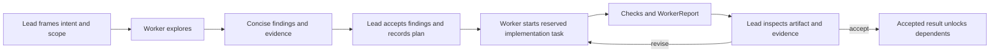

# Fusion coding teams

This page is for people who plan a coding job as a lead plus named workers and
want the TeamSpec format, the 16 team forms and the review flow. The plugin is at
version 3.3.0+swarm. The [versioned composer and execution runtime](SWARM_RUNTIME.md)
(added in 3.2) sits over these forms: independent axes, six workflows, exact
candidate reviews, observed dispatch ownership, project knowledge and supervision.
The schedules and selected-model contracts below remain valid.

The native coding workflow runs alongside the proposal graphs, panels and nested
AndrewCode Hive ([HIVE.md](HIVE.md)). The selected host leads;
named workers receive scoped briefs, communicate on one durable board, submit
evidence and wait for lead review. No model is selected or downgraded implicitly.

These 16 team forms are not the 10 runtime forms of [FORMS.md](FORMS.md)
(`/fusion:tournament`, `/fusion:delphi` and others), which dispatch to provider
CLIs. Team forms compile to board tasks for a host's native workers. Provider
and transport rules are in [PEERS.md](PEERS.md). This page uses the native
HiveBoard ([COORDINATION.md](COORDINATION.md)), not the
Vercel-Board-compatible [VBOARD.md](VBOARD.md).

## Start here

Run these from the plugin directory in PowerShell, Bash or a terminal. They need
only Python 3 and use no provider:

```bash
python fusion.py forms
python fusion.py sidekick --spec docs/examples/sidekick-team.json
python fusion.py team --spec docs/examples/map-reduce-team.json
```

`forms` prints the 16 forms as JSON (`{"pattern": "forms", "forms": [...]}`).
The two spec commands print a compiled plan with `"prepared": false`,
`"execution": "host-native"` and the first `ready` wave. The example specs use
`REPLACE_WITH_SELECTED_*_MODEL` placeholders. They compile as shipped because
the compiler only requires a non-empty model string, but they name no real model.
Output of the compile step was checked on 2026-11-22 for a pipeline spec with
one job. It printed `prepared: False`, `ready: ['fix']`, `waves: [['fix']]`.

The examples are templates: replace their model placeholders with the user's
live selected native models, set `workspace` to the real project, and scope the
jobs to that project's actual files and checks. Planning validates and schedules
without calling models or creating a board. `--prepare` creates durable tasks:

```bash
python fusion.py sidekick --spec task.json --prepare --board-db run-1/board.sqlite
python fusion.py board --db run-1/board.sqlite tasks
```

Without `--board-db`, `--prepare` writes `~/.fusion/teams/<run_id>/board.sqlite`.
Executed 2026-11-22 against a one-job pipeline spec: `ready` was `['fix']`,
`jobs_state` was `{'fix': {'state': 'queued', 'attempt': 0}}`, `worker_packets` had
one entry, and `board ... tasks` listed task `fix` created by `lead` and assigned
to `worker`.

The prepared result contains absolute `board_path`, `ready`, `jobs_state` and
`worker_packets`. **The Python planner does not spawn or execute workers.** The
`fusion-sidekick` and `fusion-team` skills drive the host's actual native spawn,
message and wait tools, review the artifacts and continue until jobs are accepted.
If native workers or a requested model are unavailable, report that gap or work
directly under the selected host; do not substitute an external CLI.

Slash commands: `/fusion:sidekick`, `/fusion:genius-boss`, `/fusion:idiot-boss`,
`/fusion:team`, `/fusion:forms`. Their backend is `swarm.sh team --spec FILE
[--form FORM] [--leadership MODE] [--prepare]`
([`commands/team.md`](../commands/team.md)), and `fusion.py` exposes the same
verbs (`team`, `sidekick`, `genius-boss`, `idiot-boss`, `forms`). The catalog marks
`forms` as `offline-catalog` and the other four as `host-native`
([`modes_catalog.py`](../python/fusion_swarm/modes_catalog.py)). To compose axes
beyond the form (communication, isolation, workflow templates), see
[SWARM_RUNTIME.md](SWARM_RUNTIME.md).

## Leadership is independent of the form

| Leadership | Lead responsibility | Worker responsibility |
| --- | --- | --- |
| `sidekick` | Frame the task, settle ambiguity, review and revise | Execute focused work; return findings, checks and blockers |
| `genius-boss` | Detailed design, interfaces, edge cases, acceptance | Follow the prescribed design; escalate deviations |
| `idiot-boss` | Preserve intent, route work, inspect results, integrate | Own technical exploration and decisions; push back with evidence |

The boss names are delegation styles, not intelligence ratings. Idiot boss mode
does not downgrade the selected lead, skip verification or widen permissions.
Choose strong autonomous workers explicitly when that style is appropriate;
the plugin does not rank models or promise a cost/performance improvement.

Use `--leadership genius-boss` on any team form. The three leadership shortcuts
set both the corresponding form and leadership. `team --form mesh --leadership
idiot-boss` combines open peer coordination with autonomous worker decisions.

## The 16 runnable forms

Every form retains the spec's explicit dependencies and acceptance gates.
"Parallel" means ready jobs may run concurrently when their write scopes do not
overlap and the host has enough independent worker sessions.

| Form | Schedule or mechanic | Coordination |
| --- | --- | --- |
| `sidekick` | Explicit dependencies; focused execution partner | Lead and assigned worker |
| `genius-boss` | Prescriptive briefs and explicit dependencies | Lead owns technical decisions |
| `idiot-boss` | Intent briefs and explicit dependencies | Expert workers own technical decisions |
| `dag` | Only declared prerequisites gate each job | Lead plus dependency handoffs |
| `pipeline` | Add an ordered chain | Stage results passed forward |
| `relay` | Add an ordered specialist chain | Compact successor handoffs |
| `fan-out` | Independent jobs plus any declared dependencies | Results return to lead |
| `hub-spoke` | Independent jobs coordinated centrally | Lead is the hub |
| `map-reduce` | Last job depends on every preceding map job | Final worker consolidates accepted outputs |
| `diamond` | First framing job → middle branches → final integration | Branch findings converge |
| `ring` | Ordered handoffs; optional bounded `rounds` unrolls the chain | Neighbor peers and lead |
| `mesh` | Declared dependencies, disjoint parallel writes | All selected peers |
| `blackboard` | Declared dependencies and shared versioned context | All peers coordinate through the board |
| `review-pair` | Ordered jobs; adjacent jobs use different workers | Builder/reviewer handoffs |
| `builder-breaker` | Ordered jobs; adjacent jobs use different workers | Build, challenge, repair as declared jobs |
| `council` | Independent read-only proposals → final adjudication | Preserve dissent and evidence gaps |

Only ring accepts `rounds > 1`. It creates explicit `.r2`, `.r3` job IDs rather
than an unbounded loop. Pipeline, relay and ring order jobs as declared in the
spec. Diamond requires at least three jobs; map-reduce, review-pair, builder-breaker
and council require at least two. Peer lists guide the workflow; they are not transport access controls.
Forms with similar schedules differ in brief and communication policy. They do
not imply separate inference algorithms or an autonomous background scheduler.

## TeamSpec

```json
{
  "run_id": "fix-123",
  "task": "Fix the reported parser defect",
  "workspace": "/path/to/project",
  "form": "pipeline",
  "leadership": "sidekick",
  "allowed_models": ["selected-lead-model", "selected-worker-model"],
  "roster": [
    {"id": "lead", "provider": "native", "model": "selected-lead-model", "role": "lead"},
    {"id": "worker", "provider": "native", "model": "selected-worker-model", "role": "worker"}
  ],
  "jobs": [
    {
      "id": "fix",
      "assigned_to": "worker",
      "goal": "Implement the reviewed parser fix",
      "reads": ["src/parser.py", "tests/test_parser.py"],
      "writes": ["src/parser.py", "tests/test_parser.py"],
      "checks": ["python -m unittest discover -s tests -p test_parser.py"],
      "constraints": ["Preserve the public parser API"],
      "dependencies": [],
      "success_criteria": ["Regression passes and existing parser behavior is preserved"]
    }
  ]
}
```

Exactly one roster seat is the lead; jobs name a different registered worker.
Seat roles can be lead, worker, reviewer, researcher or integrator. `provider`
identifies the intended host seat; it does not select a subprocess adapter.
`model` is mandatory. `allowed_models` defaults to the roster's models, or may
be a stricter explicit allowlist. Unknown seats/models and silent substitutions
are rejected. A Claude-backed seat (provider `claude`, `claude-code` or `fable`) needs an explicit
user request and `--allow-claude`; that flag only permits the declaration and calls
no provider.

Paths are concrete relative or absolute paths contained in the resolved existing
workspace. Directory scopes are allowed; globs and symlink escapes are rejected.
The compiler rejects unordered overlapping write scopes, missing dependencies
and cycles. New jobs cannot override the team's workspace or leadership.

Preparation is transactional and safe to repeat with an identical spec. One board
is bound to one team plan; a different plan cannot overwrite that run. Prepare
again after reviews to get the new ready frontier. Changing scope requires a new
run/spec; review notes and versioned context carry ordinary revisions.

## Execution and review



Each worker calls `start-task` before writing; it requires accepted dependencies,
reserves writes and returns an attempt number. Renew file leases before expiry.
Check the inbox at task boundaries or native notifications, acknowledge processed
mail, and use native wait/join for completion. Keep a worker's own context across
revisions; exchange briefs and results instead of whole transcripts.

A report submitted through `submit-task --report-file` has this shape:

```json
{
  "task_id": "fix",
  "attempt": 1,
  "status": "complete",
  "summary": "Parser defect fixed; regression and existing cases pass",
  "changed_paths": ["src/parser.py", "tests/test_parser.py"],
  "evidence": [
    {"command": "python -m unittest discover -s tests -p test_parser.py", "exit_code": 0, "output": "12 tests passed"}
  ],
  "gaps": [],
  "decision_request": ""
}
```

`complete` requires successful evidence for every requested check, no failed
evidence or unresolved gaps, in-scope changed paths and active write ownership.
It enters `review`, not `accepted`. `partial`/`blocked` enters `blocked`;
`escalate` enters `escalated` and names a decision or gap. Unfinished work cannot
be accepted. Only the task's lead may review the current attempt:

```bash
python fusion.py board --db run-1/board.sqlite review-task --agent lead --task-id fix --attempt 1 --decision accept --note "Inspected diff and actual test output"
```

`--decision` accepts `accept`, `revise`, `escalate` or `cancel`. `start-task`
takes `--agent`, `--task-id` and optional `--lease-seconds`; `submit-task` takes
`--agent` and `--report-file`.

Checks in a report are worker assertions, not an execution recorder. Inspect
the real artifacts and outputs; run missing necessary checks. Code changes,
provider calls and host permission enforcement remain the native host's job.

See [coordination](COORDINATION.md) for mail, shared context and recovery, and
[research provenance](RESEARCH.md) for the local PDFs, diagram and repositories.
