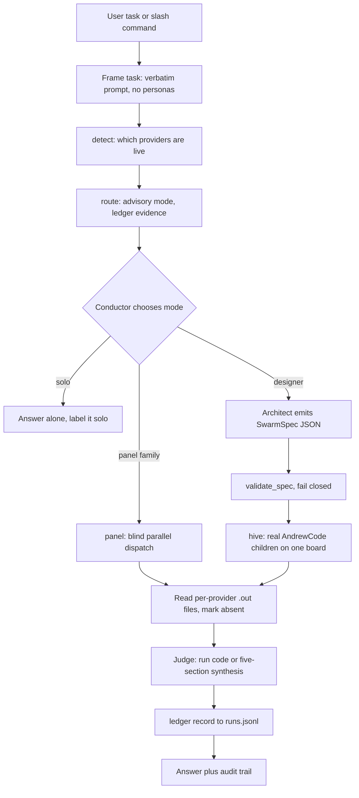

# Concepts

This page explains how the Fusion plugin thinks: what it is, the words the rest of the documentation uses, how a task gets routed, and the rules that keep a multi-model run honest. Read it before the mode, forms or peers references if you want the mental model first. It contains no install steps (see [GETTING_STARTED.md](GETTING_STARTED.md)).

A naming note, stated once. The repository is `agent-swarm-fusion`. The plugin id, the `/fusion:*` slash commands, the Python package `fusion_swarm`, the MCP servers `fusion-coordination` and `fusion-board`, and the `FUSION_*` environment variables all keep the `fusion` name. The version is `3.3.0+swarm` (`plugin.json`, `.claude-plugin/plugin.json`).

## What the plugin is

Fusion lets one model coordinate other models. It does not call a model API itself. Every "agent call" is a local command-line program that Fusion starts, feeds a prompt file, and reads back.

Three layers do different jobs:

| Layer | Examples | Role |
| --- | --- | --- |
| Host | Claude Code, Codex CLI, AndrewCode | The harness you type into. It loads the skills and commands, owns the conversation, and does the judging and synthesis. |
| Fusion | skills, `scripts/*.sh`, `python/fusion_swarm/` | Decides how to collaborate, moves bytes, keeps books. Contains no model. |
| Provider | codex seat, copilot, opencode, grok, kimi, andrewcode, agy, fable | A local model CLI that Fusion dispatches to. |

The split is stated in the scripts. `scripts/fusion.sh` says the conductor "does all reasoning/judging/synthesis" and the script "only moves bytes and keeps books". `CLAUDE.md` puts it as "the skill prose *is* the program". The consequence is that most orchestration logic lives in markdown under `skills/`, and the Python and bash code is deliberately dumb plumbing plus validators.

### Which host is in charge

The host is resolved in two places that use slightly different rules.

- Python (`python/fusion_swarm/peers/policy.py`, `detect_host`): the known hosts are `claude`, `codex`, `andrewcode`, `kimi` and `unknown`. If `CLAUDECODE=1` or `CLAUDE_CODE_ENTRYPOINT` is set, the host is `claude`, even when `FUSION_HOST=codex` is inherited, unless `FUSION_HOST_EXPLICIT=1`.
- Bash (`scripts/fusion.sh`, `scripts/route.sh`, `scripts/providers/detect.sh`): `FUSION_HOST` defaults to `codex` and the Claude markers are not consulted. Set `FUSION_HOST` yourself when running the bash verbs from another host.

The host never runs as its own provider. `fusion.sh dispatch` refuses to start the provider that equals `FUSION_HOST` and exits 3 with "is the host runtime", and `panel` records it as `host-native` (`scripts/fusion.sh:68-71`, `:107`). Python's `adapter.available()` and `DEFAULT_PANEL` exclude it for the same reason (`adapter.py:340`, `:57`).

## Vocabulary

Terms are used the same way across all pages. Each line names the code that defines it.

| Term | Meaning | Defined in |
| --- | --- | --- |
| host | The harness the user runs. | `peers/policy.py` (`HOSTS`) |
| provider | A local model CLI Fusion dispatches to. Dispatchable adapters are `codex`, `copilot`, `opencode`, `grok`, `kimi`, `andrewcode`, `agy`, `fable`. | `scripts/fusion.sh` (`adapter_for`) |
| seat | One participant slot with an id, provider, model and role. In a native team a seat is a `TeamSeat` (`lead`, `worker`, `reviewer`, `researcher`, `integrator`). In a Hive it is an `AgentIdentity` (`architect`, `operator`, `captain`, `worker`, `child`). | `team.py`, `identities.py` |
| mode / command | A `/fusion:<name>` slash command. One file per command in `commands/`. | `modes_catalog.py` |
| panel | The set of providers that answer the same prompt independently. Base panel: `codex`, `copilot`, `opencode`, `grok`. | `modes_catalog.py` (`BASE_PANEL`) |
| panelist | One provider on a panel. | |
| judge / conductor | The host model that reads the panelists' output and writes the answer. | `skills/fusion-orchestrate/SKILL.md` |
| native team forms | The 16 forms in the TeamSpec runtime (3 leadership styles plus 13 topologies). | `strategies.py` (`FORM_DETAILS`) |
| runtime forms | The 10 executable forms in `python/fusion_swarm/forms/`. | `modes_catalog.py` (`RUNTIME_FORM_COMMANDS`) |
| HiveBoard | The native SQLite WAL board behind the `fusion-coordination` MCP server. | `board.py` |
| VBoard | The Vercel-Board-compatible port behind the `fusion-board` MCP server. | `python/fusion_swarm/vboard/` |
| Hive | The nested architect, captain and child AndrewCode swarm. | `hive.py`, `designer.py` |
| ledger | Append-only record of past runs used to sharpen routing advice. | `scripts/ledger.sh` |

Two counts are easy to confuse. "Forms" means the 16 native team forms in the TeamSpec runtime (`docs/CODING_TEAMS.md`) or the 10 runtime forms in `forms/` (`docs/FORMS.md`). They are different mechanisms. The runtime forms also appear as commands such as `/fusion:tournament`.

To re-check the counts:

```bash
PYTHONPATH=python python3 - <<'EOF'
from fusion_swarm import modes_catalog as m, strategies
print("command files:", len(m.all_modes()))
print("runtime forms:", len(m.RUNTIME_FORM_COMMANDS))
print("native team forms:", len(strategies.REGISTRY))
EOF
```

Output when run against this repository:

```text
command files: 54
runtime forms: 10
native team forms: 16
```

## How a task is routed

There are two separate routers. They answer different questions and are easy to mix up.

### 1. Which collaboration mode: `route.sh`

`fusion.sh route "<task>"` runs `scripts/route.sh`, a keyword heuristic. It is advisory. Its own header says the conductor "makes the final call". It greps the task text for signals (code, a checkable value, deliberation, either/or, large scale, graph, plan review) and prints a mode.

Checked order (`scripts/route.sh:48-89`): explicit `genius boss`, `idiot boss` or `sidekick` wording, then coding-team wording, race, harden, island-evolve, plan review (`ureview`), then `solo` for short prompts with no signals, then `vote`, `debate`, `graph`, `council`, `swarm`, and finally `panel`.

Real output from two runs in a scratch copy:

```bash
bash scripts/route.sh "Compare Postgres vs MySQL for our billing service and recommend one"
bash scripts/route.sh "what is 17*23"
```

```text
MODE=council
TASK_TYPE=decision
REASON=high-stakes open decision — multi-round council with anti-conformity beats one pass
PANEL=copilot,opencode,grok
SIGNALS=code:0 verifiable:0 deliberate:1 debate:0 large:0 graph:0 ureview:0 len:67
LEDGER=none yet
NOTE=advisory default — the Conductor may override based on task nuance + LEDGER

MODE=solo
TASK_TYPE=quick
REASON=short, single-answer prompt — fusion would not earn its cost; answer solo
PANEL=copilot,opencode,grok
SIGNALS=code:0 verifiable:0 deliberate:0 debate:0 large:0 graph:0 ureview:0 len:13
LEDGER=none yet
NOTE=advisory default — the Conductor may override based on task nuance + LEDGER
```

`PANEL` lists `copilot,opencode,grok` because the default host is `codex`, which is removed from the panel (`route.sh:93-94`). For the team modes it prints `explicit-native-roster` instead.

### 2. Which tier does the work: risk policy

`python/fusion_swarm/policy.py` routes one validated `TaskSpec` (MetaLoop) to a tier: `host`, `expert` or `fast`. Hard overrides win first, then a score, and every decision records its reason.

1. Hard override. If `category` or `objective` contains a marker for auth, secrets, migrations, money, legal, public contracts, architecture, production config, merge conflicts or final integration, the task stays on the host. High-risk host work also sets `advisor_preflight`. Destructive, production or paid-large markers set `needs_human_approval`.
2. Score. `expert_pressure = 2*risk + 2*complexity + context_size + novelty + ambiguity + blast_radius - latency_priority - verification_strength`.
   - 8 or more: expert lane.
   - 3 or less with `risk <= 1`: fast lane.
   - Otherwise the host chooses, using provider strengths and ledger evidence.

Verification strength is 2 for a `verification_cmd` plus 1 for acceptance criteria, capped at 3, so a task a gate can check pulls toward the fast lane.

Real output (three `TaskSpec` objects through `policy.route`):

```text
t1 fast -6 False expert_pressure=-6 <= 3 and risk<=1 -> fast lane
t2 host 3 True hard override: 'auth' is Chief-Operator-owned work
t3 expert 14 False expert_pressure=14 >= 8 -> expert lane
```

Each line is `task_id tier expert_pressure hard_override reason`. The marker match is a case-insensitive substring match. A category such as `author_docs` also triggers the `auth` override (run and confirmed), so choose category names with that in mind. The tests that pin the behavior are in `tests/test_metaloop.py` (`TestRouting`). The docstring says plainly that this is "NOT an ML model".

## Sidekick, genius-boss and idiot-boss

These three are leadership styles for coding work done by native workers of the host. They are defined as `LEADERSHIP_MODES` in `python/fusion_swarm/sidekick.py`, and `worker_prompt` writes the instruction each worker receives.

| Style | Who decides the design | Worker instruction (from `worker_prompt`) |
| --- | --- | --- |
| `sidekick` | The lead | Execute a focused brief. Return ambiguity and architecture choices to the lead. |
| `genius-boss` | The lead, in detail | Follow the specified interfaces. Escalate deviations before editing. |
| `idiot-boss` | The worker | Own technical decisions inside the brief and challenge a flawed plan with evidence. The coordinator routes work and checks results. |

The same three names are also the first three of the 16 native team forms. A strategy records `decision_owner` as `expert-workers` for `idiot-boss` and `selected-lead` otherwise (`strategies.py`).

What a team run is, in practice:

- You provide a TeamSpec with an explicit roster, scoped jobs and success criteria. `fusion.sh team ...` without `--spec` prints the form catalog and says `"execution": "not dispatched"` (`team.py`, `run`).
- `compile_spec` validates the spec and orders the jobs into waves. Preparing a run queues the jobs on a HiveBoard.
- A worker's report is validated against its brief. A report may only change paths inside the brief's `writes`, and `complete` requires every requested check to have passed with no gaps (`sidekick.py`, `WorkerReport.from_dict`).
- Planning and preparation call no model adapter. Dispatch is done by the host's own native worker tools.

See [CODING_TEAMS.md](CODING_TEAMS.md) for the forms and [MODES.md](MODES.md) for the commands.

## Honesty invariants

These are rules the plugin keeps even when they make a run look less impressive. For each one, the table names where it is enforced and what would catch a regression. Many are enforced by validators in code. Others live in skill prose, and the only guard is a grep in `tests/validate.sh` that the sentence is still present. The table says which is which.

| Invariant | What it means | Enforced by | Kind of guard |
| --- | --- | --- | --- |
| Real dispatch only | The conductor never writes what a panelist "would say". A skipped dispatch is a `solo` run and is labelled `solo`. | `skills/fusion-orchestrate/SKILL.md` ("MANDATORY COMPLIANCE") | Prose, grep-checked at `tests/validate.sh:76` |
| Absent is never agreement | A provider that failed, timed out or never ran does not endorse the survivors. Consensus is computed over returners only. | `adapter.returning()` keeps only replies with `ok` and non-empty text. `fusion.sh panel` maps exit codes to `returned`, `timeout` (124), `absent` (127) or `error`, and an empty `.out` file downgrades `returned` to `error`. `modifiers.anonymize` labels only returners. | Code, plus grep at `tests/validate.sh:78`. Behavior tests: `tests/test_spawn.py` (`test_absent_status`), `tests/test_graph.py` (`test_absent_input_is_stated_never_silently_dropped`) |
| Judge stays off the panel | The model that judges is not also a blind panelist. | The host is excluded from `adapter.available()` and `DEFAULT_PANEL`. `fusion.sh dispatch` refuses the host (exit 3). Forms pick a judge outside the authors, for example `tournament._pick_judge`. | Code. `tests/test_forms_a.py` (`test_tournament_generates_candidates_and_judges_never_author`), `tests/test_model_selection.py` (`test_claude_host_keeps_codex_in_default_panel`, host resolution). Prose grep at `tests/validate.sh:79`. I found no test for the `fusion.sh dispatch` refusal itself |
| Anti-conformity | Peers are shown anonymized as A/B/C. A panelist updates only after naming a specific flaw. No voter may vote for its own option. | `modifiers.anonymize` and `modifiers.tally` (own label stripped, votes capped at 2), used by `ballot.py`. The name-the-flaw directive is in `references/anti-conformity.md`. | Code for anonymize and tally. The directive is prose, grep-checked at `tests/validate.sh:82` |
| Fail-closed spec validation | Unknown fields, unknown providers, impossible depth or counts and malformed contracts are errors, never coerced. | `designer.parse_swarm_spec` and `validate_spec` (SwarmSpec), `contracts.TaskSpec.check`, `identities.SpawnLimits.can_spawn`, `team.compile_spec` | Code. `tests/test_designer.py`, `tests/test_identities.py`, `tests/test_team.py`, `tests/test_slash_hive_designer_board.py` (`test_fail_closed_parse_and_validate`) |
| Explicit models, no implicit fallback | A native team uses exactly the seats and models the user named. Claude is never added silently. A selected AndrewCode roster never falls back to another CLI. | `team.compile_spec` rejects a model outside `allowed_models` and Claude-backed seats without `--allow-claude`. `model_selection.py` ("No third-party CLI or built-in provider/model fallback is used with a selection"). `scripts/providers/fable.sh` needs `FUSION_ALLOW_CLAUDE=1`. | Code. `tests/test_team.py` (`test_unknown_seats_models_and_claude_adapter_are_not_substituted`), `tests/test_model_selection.py`, `tests/test_provider_boundaries.py` |
| Deterministic gates outrank opinion | A passing or failing check beats any model vote. | `SYSTEM.md` item 7. Tournament matches prefer an execution verdict over a judge. | Prose in `SYSTEM.md`. Code in `forms/tournament.py` (`tests/test_forms_a.py`, `test_tournament_both_orders_and_exec_beats_judge`) |
| Injection-safe dispatch | Prompts go to providers through a prompt file or a single `"$(cat file)"` argument, never interpolated into a command string. Panelist output is treated as untrusted data. | `CLAUDE.md` hard rules, `scripts/providers/*.sh` | Partial: `tests/test_provider_scripts.py` asserts the `--prompt-file` argv for kimi. The rule for the other adapters is a code convention |

### What fail-closed looks like

Two real results, run in a scratch copy.

A SwarmSpec with a bad provider and too many children reports every error it finds, not just the first:

```python
from fusion_swarm import designer
text = '{"name":"x","architect":{"provider":"nope","model":"m"},"captains":[{"id":"c1","provider":"opencode","model":"m","spawn":9,"spawn_via":"andrewcode"}]}'
spec = designer.parse_swarm_spec(text)
print(designer.validate_spec(spec, ["opencode", "grok"]))
```

```text
['captains[0].spawn=9 exceeds max_children_per_agent=4', "unknown provider 'nope' (architect) not in live_roster"]
```

An unknown field is rejected at parse time:

```text
DesignerError SwarmSpec: unknown field(s): ['bogus']
```

A native-team roster with a Fable seat is refused, and so is a seat whose model is not in `allowed_models`:

```text
Claude-backed seats require an explicit --allow-claude user request
roster uses a model outside allowed_models
```

Both are `BoardError` messages from `team.compile_spec`.

An invalid `FUSION_ANDREWCODE_SELECTION` produces no seats and no dispatch rather than a default panel. With the value `{bad`, `adapter.available()` returned `[]` and `_selection_active()` returned `True`. The error text never echoes the value (`tests/test_model_selection.py`, `test_invalid_env_never_echoed`).

## Identity, seats and limits

Every Hive participant is an `AgentIdentity` (`python/fusion_swarm/identities.py`):

- Fields: `id`, `display_name`, `role`, `provider`, `model`, `parent_id`, `lineage`, `depth`, `spawn_budget`, `max_depth`, `status`.
- Roles: `architect`, `operator`, `captain`, `worker`, `child`.
- `lineage` is a slash path of ids, for example `arch/muse/muse-2`. An id may not contain `/`.
- `child()` derives `parent_id`, `lineage` and `depth` itself and refuses to take them as arguments.

`SpawnLimits` is the pre-spawn gate. Defaults: `max_depth=2`, `max_children_per_agent=4`, `max_agents=24`. `can_spawn` returns `(ok, reason)` and refuses when the parent is at depth, already has the maximum children, or the swarm is full. `SwarmSpec` carries its own limits and `validate_spec` checks the seat count against `max_agents` before anything spawns.

A native team has simpler seats. A `TeamSeat` is `id`, `provider`, `model` and `role`, and a spec needs exactly one `lead` that represents the host the user selected (`team.py`). Seat ids are what job `assigned_to` fields and strategy role bindings refer to.

The board identity travels in the environment. Spawned Hive children receive `FUSION_BOARD`, `FUSION_AGENT_ID`, `FUSION_PARENT_ID` and `FUSION_SWARM_ID` (`skills/fusion-orchestrate/references/collaboration-modes.md`, "hive"), and `board.default_board_db()` honors `FUSION_BOARD` first. Details are in [HIVE.md](HIVE.md) and [PEERS.md](PEERS.md).

## Where state lives

The core flow needs no daemon. State is plain files and SQLite under a user directory, so it survives plugin updates and works when the installed plugin directory is read-only.

| What | Default location | Set by | Created by |
| --- | --- | --- | --- |
| Run ledger and derived lessons | `~/.fusion/memory/runs.jsonl`, `lessons.md` | `FUSION_STATE_DIR`, `FUSION_MEMORY_DIR` | `scripts/ledger.sh` (the plugin's own `memory/` is only a seed) |
| Degraded-provider list | `~/.fusion/degraded-providers` | `FUSION_STATE_DIR` | `scripts/ledger.sh` |
| Hive board per run | `~/.fusion/hive/<run_id>/board.sqlite` | `FUSION_STATE_DIR`, `--state-dir` | `hive.py` |
| Board CLI default | `~/.fusion/hive/board.sqlite` | `FUSION_BOARD`, `FUSION_STATE_DIR` | `board.py` (`default_board_db`) |
| Native team board | `~/.fusion/teams/<run_id>/board.sqlite` when run with `--prepare` and no `--board` | `--board` | `team.py` (`run`) |
| Runtime form runs and journals | `~/.fusion/forms/runs/` | `FUSION_HOME` | `forms/runtime.py` |
| Reliability ledger (forms) | `~/.fusion/ledger/reliability.json` | `FUSION_LEDGER_PATH` | `forms/ledger.py` |
| UltraSwarm selection | `~/.fusion/ultraswarm/last_selection.json` | `FUSION_STATE_DIR` | `scripts/ultraswarm_selector.py` |

Two details to know. `FUSION_STATE_DIR` and `FUSION_HOME` are separate variables read by different modules, both defaulting to `~/.fusion`. And `strategies.py preview --prepare` without `--board` writes the board under the workspace (`<workspace>/.fusion/<run_id>/board.sqlite`), not under the home directory. The full variable list is in [CONFIGURATION.md](CONFIGURATION.md).

A real Hive dry run in a scratch state directory creates the per-run board and posts the seed messages without starting any process:

```bash
FUSION_STATE_DIR="$PWD/state" bash scripts/swarm.sh hive "demo goal" --dry-run
```

```text
=== fusion swarm: hive ===
run_id: hive-07e208a104  dry_run: True
board: <state>/hive/hive-07e208a104/board.sqlite
agents: 12  posts_seeded: 3
talk on the board: python -m fusion_swarm.board --db <state>/hive/hive-07e208a104/board.sqlite poll --agent arch
```

The run id is random and the board path was shortened to `<state>`. Two boards exist, HiveBoard and VBoard, and they are not interchangeable. [COORDINATION.md](COORDINATION.md) covers HiveBoard and [VBOARD.md](VBOARD.md) covers VBoard.

## Anatomy of a run

For a panel-family mode the flow is the same. The conductor frames the task, reads the room, picks a mode, dispatches blind and in parallel, judges from the files that came back, and records the run. For `hive` and `designer` the conductor does not invent the topology (see [HIVE.md](HIVE.md)).



In words: the conductor restates the task and writes the user's text verbatim into a prompt file, with one fixed neutral instruction and no personas (`references/panel-doctrine.md`). `fusion.sh detect` reports which providers are live and `fusion.sh route` offers a mode, but the conductor decides. For the panel family, `fusion.sh panel` starts every live provider in the background and writes `<out_dir>/<provider>.out` plus a status line (`returned`, `absent`, `timeout` or `error`). `council` and `debate` re-dispatch later rounds with anonymized peer answers and the name-the-flaw directive. For `designer`, a frontier architect emits only SwarmSpec JSON, which must pass `validate_spec` before `hive` spawns anything. The conductor then reads the returned files. For code it runs the candidates and merges only what it saw work. For research it writes the five sections: consensus, contradictions, partial coverage, unique insights and blind spots (`references/judge-rubric.md`). `ledger.sh record` appends the run, and the answer is presented with an audit trail that states who returned and who was absent (`references/verdict-contract.md`).

The same spine runs under the runtime forms and Python engine patterns, with their own budgets and journals. See [FORMS.md](FORMS.md).

## Known inconsistencies in the source

These are mismatches and ambiguities found while writing this page.

- Some skill prose and script comments call the conductor "Codex" (for example `skills/fusion-orchestrate/SKILL.md` and the headers of `route.sh` and `fusion.sh`), while `CLAUDE.md` describes the conductor as Claude. The conductor is whichever host loaded the skill. The bash default of `FUSION_HOST=codex` is a legacy default, not a statement about your host.
- `plugin.json` describes the plugin as having "16 forms, six workflows". Both are verified in source: 16 is `len(strategies.REGISTRY)` (the native team forms), and six is `len(strategies.WORKFLOWS)`: `feature-delivery`, `reproduce-build-verify`, `migration-waves`, `contract-first-api`, `review-and-revise` and `ci-repair`. The workflows are job-stage templates for native teams, not slash commands. They are separate from the 10 runtime forms and from the 54 command files.

## Related

- [MODES.md](MODES.md) lists every slash command and what it does.
- [FORMS.md](FORMS.md) covers the 10 runtime forms, budgets and the journal.
- [CODING_TEAMS.md](CODING_TEAMS.md) covers the 16 native team forms.
- [HIVE.md](HIVE.md) covers the nested AndrewCode swarm.
- [PEERS.md](PEERS.md) covers providers, transports and the Codex policy.
