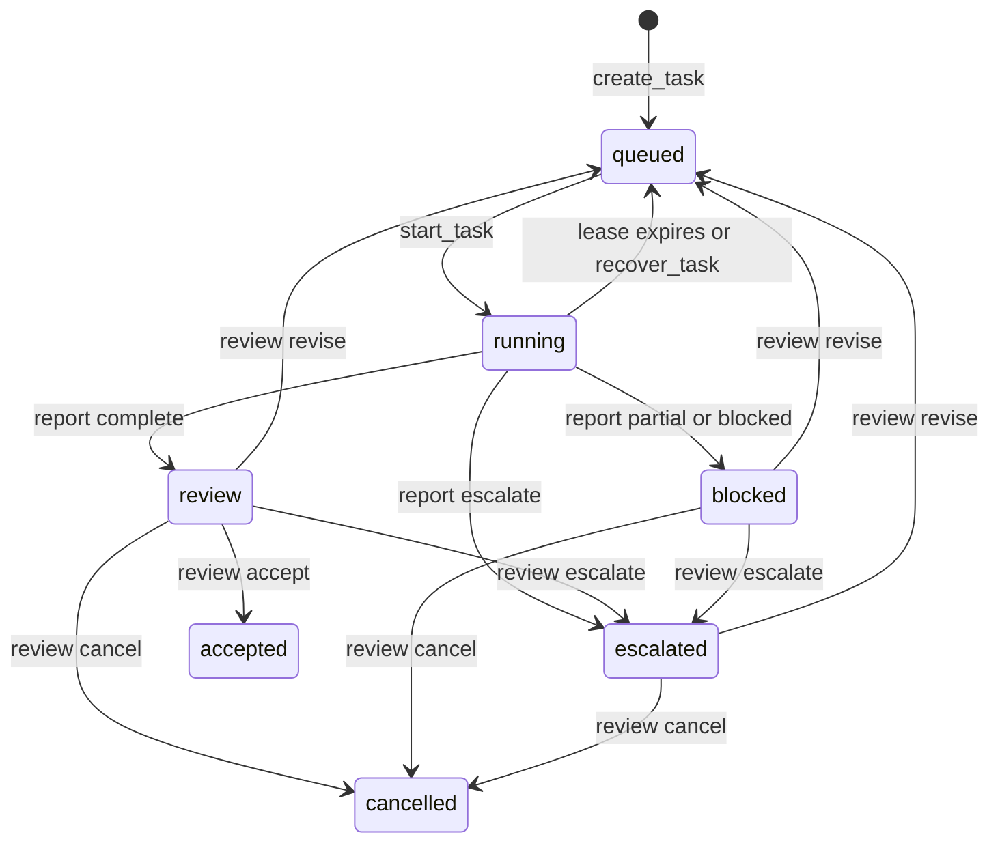

# Native coordination: HiveBoard, mailbox, tasks and the `fusion-coordination` MCP server

This page describes the native board that Fusion teams and the Hive use to talk to each other: messages with per-recipient delivery, file reservations, shared context, and a task lifecycle with lead review. Read it if you run native teams, write a worker that uses the board CLI or the stdio MCP server, or need to know what the board does and does not guarantee.

HiveBoard is one SQLite file in WAL mode. Independent local processes open the same file through the CLI or the stdio MCP server. There is no service, broker, API key or third-party Python library. The code is [`board.py`](../python/fusion_swarm/board.py) plus three mixins: [`mailbox.py`](../python/fusion_swarm/mailbox.py), [`coordination.py`](../python/fusion_swarm/coordination.py) and [`protocol.py`](../python/fusion_swarm/protocol.py). `comms` is a workspace-aware entry point to the same store, not a second mirrored log.

The repository is named `agent-swarm-fusion`. The Python package, MCP servers and environment variables keep the `fusion` name.

HiveBoard is not the Vercel-Board-compatible board. For that one, see [VBOARD.md](VBOARD.md) and the comparison at the end of this page.

## Message facts

A message goes through several states. Each state is a recorded fact, and none of the first four proves that code was written or verified.

| Fact | Meaning |
| --- | --- |
| Stored | The message and its recipient delivery rows were committed together |
| Read | The recipient fetched it through `inbox` (sets `read_at`, does not acknowledge) |
| Leased | One consumer claimed it until a deadline (`claim`) |
| Acknowledged | The recipient reported processing it; it leaves the outstanding inbox |
| Task review | The current worker report passed structural and requested-check validation |
| Task accepted | The lead reviewed and accepted the current artifact |

`poll` and `mentions` are history views and include acknowledged messages. `inbox` returns outstanding deliveries (state `pending` or `leased`), ordered by priority and then message ID. Reading records `read_at` without acknowledging.

Recipients are fixed when the message is sent: the members of the channel at that moment, registered agents named in `mentions`, and `to_agent`, minus the sender. A later registration does not receive earlier mail. Registering an agent joins it to rooms by role (source: `_ROLE_ROOMS` in `board.py`):

| Role | Rooms joined |
| --- | --- |
| `architect` | `hive`, `architect`, `system` |
| `operator` | `hive`, `architect`, `captains`, `system` |
| `captain` | `hive`, `captains` |
| `worker`, `child` | `hive`, `workers` |

`init` creates the default channels `hive`, `architect`, `captains`, `workers` and `system`.

Direct messages are visible only to the sender and the recipient. A third agent cannot reply to or acknowledge one. This is visibility enforcement for cooperative local agents. Anyone who can read the database file is trusted, and identity strings are not authentication.

### Send, read, claim and acknowledge

These commands were run against a scratch board. The values `lead`, `worker` and `m1` are placeholders, and long JSON output is trimmed.

```bash
export PYTHONPATH=python
B=/tmp/example-board.sqlite
python3 fusion.py board --db "$B" init
python3 fusion.py board --db "$B" register --id lead   --provider claude --model m1 --role operator
python3 fusion.py board --db "$B" register --id worker --provider codex  --model m2
python3 fusion.py board --db "$B" post --from lead --body "Parser contract ready" \
  --kind finding --task-id fix --idempotency-key fix-contract-v1
python3 fusion.py board --db "$B" inbox --agent worker
python3 fusion.py board --db "$B" claim --agent worker --lease-seconds 60
python3 fusion.py board --db "$B" ack --agent worker --message-id 1 --lease-token TOKEN_FROM_CLAIM
```

`init` printed:

```json
{"ok": true, "db": "/tmp/example-board.sqlite", "channels": ["hive", "architect", "captains", "workers", "system"]}
```

After `inbox`, message 1 carried this delivery record (trimmed):

```json
{"id": 1, "channel": "hive", "from_agent": "lead", "kind": "finding", "task_id": "fix", "priority": "normal",
 "delivery": {"message_id": 1, "agent_id": "worker", "state": "pending", "attempts": 0, "lease_token": null, "acked_at": null}}
```

After `claim` the same message had `"state": "leased"`, `"attempts": 1` and a 32-character hex `lease_token`. `ack` with a wrong token failed with `{"ok": false, "error": "stale delivery lease token"}`. `ack` with the real token returned `{"agent_id": "worker", "message_id": 1, "acked_at": "..."}`, after which `poll` still listed the message and `inbox` did not.

Rules worth knowing:

- **Idempotency.** Use a stable `idempotency_key` for retries. The same sender, key and content returns the original message. Different content fails with `idempotency key reused with different message content`.
- **Kinds.** Allowed values are `message`, `system`, `ack`, `presence`, `task`, `handoff`, `finding`, `blocker`, `decision` and `review`. Priorities are `low`, `normal` and `urgent`.
- **Input files.** Attach JSON with `--payload-file`. Use `--body-file` for multiline bodies. Do not send secrets or transcripts.
- **Leases.** `claim` leases pending deliveries atomically (default 1 message, 60 seconds). A competing consumer cannot claim an active lease. When a lease expires, or after `nack`, the message is available again with a fresh token and a higher attempt count. A stale token cannot acknowledge a newer consumer's lease.
- **At-least-once.** Delivery can repeat, so consumer side effects must tolerate redelivery. Acknowledge after processing.
- **No wakeup daemon.** Check the inbox on native events or task boundaries. The `wait` verb blocks until the board changes, using `kqueue` on macOS and a 50 ms file poll elsewhere. `wait --hook-rewake` prints new messages to stderr and exits 2. Nothing notifies another host on its own.

### Versioned envelopes, retries and dead letters

`send_message` (CLI `send-message --envelope-file`, MCP `send_message`) wraps a direct message in a versioned envelope. Fields are `schema_version` (1), `run_id`, `trace_id`, `purpose`, `summary` (at most 4000 characters), `requested_action`, `task_id`, `attempt`, `reply_to`, `artifacts`, `deadline`, `max_attempts` and `progress_key`. The `purpose` is one of `assignment`, `handoff`, `question`, `answer`, `decision`, `blocker`, `finding`, `progress`, `stop`. An `answer` needs `reply_to`. `requested_action` is required except for `progress`. The source is `message_envelope` in `protocol.py`.

- **Retry budget.** Plain mail is dead-lettered after 8 claim attempts unless `FUSION_MAIL_MAX_ATTEMPTS` is set to a positive integer. An envelope's `max_attempts` defaults to 3 and cannot exceed 20. A `deadline` expires pending or leased deliveries.
- **Dead letters.** A delivery in state `dead` cannot be claimed or acknowledged. `dead-letters --agent ID` lists them and `retry-delivery --agent ID --message-id N [--extra-attempts K] [--deadline T]` reopens one for its recipient only. `retry-delivery` works for mail sent with an envelope (`send-message --envelope-file`); for mail sent with plain `post --to` it failed with a `TypeError` in testing, see [Troubleshooting](TROUBLESHOOTING.md).
- **Progress supersession.** A newer `progress` envelope with the same run, task, attempt and `progress_key` marks older pending ones from the same sender as `superseded`.
- **Stale attempts.** Mail for a task attempt that is not the current one, or for an accepted or cancelled task, is refused. Lead `decision` and `stop` mail for the current attempt is allowed.
- **Effects.** `consume-delivery` records one database effect row keyed by `effect_key` and acknowledges the delivery in the same transaction. It deduplicates that row only. External side effects need their own idempotency.
- **Trace.** `trace --agent ID --run-id RUN` returns visible correlated messages, receipts, and `unanswered_questions`. Recipients' lease tokens are never shown to a sender.

## File ownership and shared context

`reserve --agent ID --workspace DIR --paths PATH [PATH ...]` takes concrete path leases (default 900 seconds). Globs are refused and paths must stay inside the workspace after symlink resolution. A reservation conflicts when its path is the same as, an ancestor of, or inside another agent's or another task's lease. The error reads `write collision: <path> reserved by <agent> (<task>)`. Renew by calling `reserve` again before expiry. `release` is for the owner only, and `reservations` lists active leases. These are advisory ownership rules, not an OS sandbox. They cannot stop a process that ignores the protocol.

`context-get --namespace RUN --key CONTRACT` returns the value, author and version. `context-set --agent ID --namespace RUN --key CONTRACT --value-file FILE --expected-version N` updates atomically. A missing key has version 0, and `found: false`. A stale version fails instead of overwriting a peer: in the scratch run a second write with `--expected-version 0` returned `stale context version: expected 0, actual 1`. Team preparation provides a run-specific `context_namespace` (set to the run ID in `team.py`). Store interface contracts, decision rationale and evidence pointers, with a small payload and a named owner.

## Task lifecycle and recovery

A lead creates a validated brief, the assigned worker starts an attempt, reports, and the lead reviews.



In words: `create_task` queues a task. `start_task` moves it to `running` and increments the attempt. A worker report maps `complete` to `review`, `partial` and `blocked` to `blocked`, and `escalate` to `escalated`. The lead's `review_task` decision then maps `accept` to `accepted` (only from `review`), `revise` to `queued`, `escalate` to `escalated` and `cancel` to `cancelled`. A running attempt returns to `queued` when its lease expires or when the lead runs `recover_task`. Source: `submit_task`, `review_task`, `recover_task` and `_expire_tasks_unlocked` in `coordination.py`.

A brief has `id`, `goal`, `workspace`, `assigned_to`, `writes`, `checks` and `success_criteria`, plus optional `reads`, `dependencies`, `constraints`, `role`, `mode`, `candidate_of` and `review_stage` (the `TaskBrief` dataclass in [`sidekick.py`](../python/fusion_swarm/sidekick.py)). A report has `task_id`, `attempt`, `status`, `summary`, `changed_paths`, `evidence` and `gaps`. The tests build both in `tests/test_coordination.py`.

```bash
python3 fusion.py board --db "$B" create-task --agent lead   --brief-file brief.json
python3 fusion.py board --db "$B" start-task  --agent worker --task-id fix
python3 fusion.py board --db "$B" submit-task --agent worker --report-file report.json
python3 fusion.py board --db "$B" review-task --agent lead --task-id fix --attempt 1 \
  --decision accept --note "Inspected diff and verification"
python3 fusion.py board --db "$B" task-history --task-id fix
```

I ran this sequence with a recovery in the middle. `task-history` printed the transitions as `queued (lead)`, `running 1 (worker)`, `queued 1 (lead, recovery)`, `running 2 (worker)`, `review 2 (worker)`, `accepted 2 (lead)`. Re-sending the same brief returned the existing task unchanged, and `start-task` after the recovery began attempt 2.

What the board enforces:

- **Transactions.** Brief creation with its notification, report submission with the lead notification, and a review with its decision mail each commit together.
- **Attempt fencing.** Each start increments the attempt. Reports and reviews for a different attempt are rejected, and the old attempt cannot submit after expiry.
- **Dependencies.** `start_task` refuses until every dependency is `accepted`. The one exception is a task's `candidate_of` dependency, which may also be in `review` when its candidate is current. `start_task` also reserves the brief's `writes` paths.
- **Lease and renewal.** `start_task` takes `lease_seconds` (default 900). The worker extends the running attempt and its reservations with the MCP tool `renew_task`. There is no CLI verb for it.
- **Reservations after review.** Accept, revise and cancel release the task's reservations. `escalate` keeps them.
- **Active runtimes.** `review_task` refuses accept, revise or cancel while a runtime dispatch for the task is still active, and accepting a runtime-backed attempt needs the stopped, selected-model worker with a clean observed scope.

### Recovering after a crash

Reopen the same database and inspect `tasks`, `reservations`, reports and `task-history`. **Stop the old worker and reconcile its changes first.** Then the lead may run:

```bash
python3 fusion.py board --db "$B" recover-task --agent lead --task-id fix --attempt 1 \
  --note "Worker stopped; changes reconciled"
```

`recover-task` works only for the lead that created the task, on the current `running` attempt. It releases that task's reservations and requeues it. It never terminates a process. It refuses while the worker's readiness is still `ready`, `started` or `observed`, or while a runtime dispatch is still active. A fresh start gets a new attempt, which fences delayed reports. Expired write leases alone do not prove a worker stopped. Repeating an identical team preparation preserves running and accepted work and does not duplicate briefs.

## Where the database lives

| Entry point | Default path | Override |
| --- | --- | --- |
| `fusion.py board`, `python -m fusion_swarm.board` | `$FUSION_STATE_DIR/hive/board.sqlite`, else `~/.fusion/hive/board.sqlite` | `FUSION_BOARD`, or `--db` |
| `fusion.py comms --cwd PROJECT` | `PROJECT/.andrewcode/comms/board.sqlite` | `FUSION_BOARD` wins, then `--db`, or `--dir DIR` (uses `DIR/board.sqlite`) |
| Native team `--prepare` (`team.py`) | `~/.fusion/teams/RUN/board.sqlite` | `--board-db` |
| `strategies.py preview --prepare` | `WORKSPACE/.fusion/RUN/board.sqlite` | `--board` |
| A Hive run (`hive.py`) | `<state root>/hive/<run_id>/board.sqlite` | the Hive state directory |

Always pass a prepared team's absolute path to every participant. For `comms`, `FUSION_BOARD` takes precedence over `--db`: I confirmed that with `FUSION_BOARD` set, `comms --cwd` initialized the injected path and not the project path.

Next to the database the board writes `board.sqlite.jsonl`, a greppable sidecar, and `board.sqlite.wakeup`, a counter touched after each committed transaction. SQLite is the source of truth. The sidecar is written after the outer transaction commits, and a sidecar failure is recorded without losing the committed message. Rolled-back transactions write no sidecar records. The `-wal` and `-shm` files are normal SQLite WAL companions.

Schemas are additive: existing agents, channels, history and acknowledgments stay usable after an upgrade. Recipient deliveries are created for new messages only, so older messages remain in history and are not backfilled into the inbox. The environment variables are listed in [CONFIGURATION.md](CONFIGURATION.md).

Other CLI verbs not covered above: `register`, `heartbeat`, `agents`, `tree`, `channels`, `join`, `dm`, `reply`, `poll`, `mentions`, `nack`, `receipts`, `stats`, `readiness`, and the stigmergy pair `trace-deposit` and `trace-sense` (expiring, half-life-decayed discovery marks on a locus). Every verb prints JSON, and errors print `{"ok": false, "error": ...}` with exit code 1. `python3 fusion.py board --help` lists them. See [CLI.md](CLI.md).

## The `fusion-coordination` MCP server

[`mcps/fusion-coordination/server.py`](../mcps/fusion-coordination/server.py) is a launcher for [`fusion_swarm/mcp_server.py`](../python/fusion_swarm/mcp_server.py), a stdlib newline-delimited JSON-RPC server over stdio. It writes only MCP messages to stdout and opens no board until a tool call. It reports `serverInfo` `fusion-coordination` version `3.3.0+swarm` and answers `initialize`, `ping`, `tools/list` and `tools/call`.

It has one board mode per process:

| Launch arguments | Board | Effect |
| --- | --- | --- |
| `--require-board` (plugin default) | Chosen per call by `board_path` | Every tool schema requires an absolute `board_path` |
| `--db ABSOLUTE_DB` | Fixed | A call whose `board_path` differs is rejected |
| `--workspace PROJECT` | Fixed to `resolve_board(PROJECT)` | Same as `--db`; with `FUSION_BOARD` set that path wins |
| `--agent-id ID` (optional, combinable) | n/a | Rejects a tool whose `agent_id`, `from_agent`, `created_by` or `register` id is a different actor |

The three board options are mutually exclusive. I ran the server over stdio in a scratch directory. With `--require-board`, `tools/list` returned 51 tools, each with `board_path` required. A call without it failed with `board_path is required; use the prepared team's absolute board_path`, a relative path failed with `board_path must be absolute`, and a call with an absolute path succeeded. With `--db ... --agent-id b`, a tool call as agent `a` failed with `tool actor differs from this process's bound agent`, and a different `board_path` failed with `board_path differs from this process's fixed board`. Calls for different boards use separate connections. Identity binding is a cooperative guard, not authentication.

Tool errors come back as a result with `isError: true` and a text message. Unknown fields are rejected because every schema sets `additionalProperties: false`.

### Tool table

All 51 tools are registered in the `TOOLS` list of `python/fusion_swarm/mcp_server.py`. The column "Hint" shows the tool's `readOnlyHint` annotation: `read` for true, `write` for false. `inbox` and `dead_letters` are `write` because they record read receipts or expire deliveries. The description column is a shortened paraphrase of the registered description; the registry text is the authority. Required arguments are listed first, then optional ones. Every tool also accepts `board_path`, which is required in `--require-board` mode.

To regenerate the table from the registry, run from the repository root:

```bash
PYTHONPATH=python python3 -c "
from fusion_swarm.mcp_server import TOOLS
for t in TOOLS:
    s = t['inputSchema']; req = s['required']
    opt = [k for k in s['properties'] if k not in req and k != 'board_path']
    print('|', t['name'], '|', 'read' if t['annotations']['readOnlyHint'] else 'write', '|', ', '.join(req), '|', ', '.join(opt), '|', t['description'].split('. ')[0].rstrip('.'), '|')"
```

**Identity and mail**

| Tool | Hint | Required | Optional | What it does |
| --- | --- | --- | --- | --- |
| `register` | write | `agent` | | Register a selected seat on this board; never launches a process |
| `agents` | read | | | Read registered identities and presence |
| `post` | write | `from_agent`, `body` | `channel`, `to_agent`, `kind`, `task_id`, `mentions`, `priority`, `payload`, `idempotency_key` | Commit a typed message and recipient receipts |
| `dm` | write | `from_agent`, `to_agent`, `body` | `kind`, `task_id`, `priority`, `payload`, `idempotency_key` | Send private mail to a registered peer |
| `reply` | write | `from_agent`, `message_id`, `body` | | Reply in an existing visible thread, preserving task correlation |
| `inbox` | write | `agent_id` | `limit`, `task_id` | Read outstanding deliveries and record read receipts |
| `claim` | write | `agent_id` | `limit`, `lease_seconds` | Lease pending deliveries atomically |
| `ack` | write | `agent_id`, `message_id` | `lease_token` | Acknowledge processed mail |
| `nack` | write | `agent_id`, `message_id`, `lease_token` | `reason` | Return your active lease for retry without acknowledging |
| `receipts` | read | `message_id` | `agent_id` | Inspect per-recipient stored, read, leased and acked facts |
| `stats` | read | | | Inspect queue counts and expired delivery leases |
| `send_message` | write | `from_agent`, `to_agent`, `envelope`, `idempotency_key` | `priority`, `payload` | Send a versioned envelope with an explicit action and durable trace |
| `consume_delivery` | write | `agent_id`, `message_id`, `lease_token`, `effect_key`, `result` | | Deduplicate one effect record and acknowledge the delivery |
| `dead_letters` | write | `agent_id` | | Inspect deliveries that exhausted their retry budget or deadline |
| `retry_delivery` | write | `agent_id`, `message_id` | `extra_attempts`, `deadline` | Reopen your own dead delivery with a bounded extra budget |
| `trace` | read | `agent_id`, `run_id` | `trace_id`, `limit` | Read visible correlated messages, receipts and unanswered questions |

**Ownership and context**

| Tool | Hint | Required | Optional | What it does |
| --- | --- | --- | --- | --- |
| `reserve` | write | `agent_id`, `workspace`, `paths` | `lease_seconds`, `task_id` | Reserve concrete workspace paths before writing |
| `release` | write | `agent_id`, `workspace`, `paths` | `task_id` | Release your own file reservations |
| `reservations` | read | | | Read active file ownership |
| `context_get` | read | `namespace`, `key` | | Read one scoped value with version and author |
| `context_set` | write | `agent_id`, `namespace`, `key`, `value`, `expected_version` | | Compare-and-swap update of one scoped value |

**Tasks and review**

| Tool | Hint | Required | Optional | What it does |
| --- | --- | --- | --- | --- |
| `create_task` | write | `created_by`, `brief` | | Queue a validated brief and notify its assigned worker |
| `tasks` | read | | `task_id` | Read task states, briefs and worker-reported evidence |
| `start_task` | write | `agent_id`, `task_id` | `lease_seconds` | Start an assigned queued task when dependencies are accepted |
| `submit_task` | write | `agent_id`, `report` | | Submit the current attempt's report and notify the lead |
| `review_task` | write | `agent_id`, `task_id`, `attempt`, `decision`, `note` | | Lead accepts, revises, escalates or cancels a submitted attempt |
| `renew_task` | write | `agent_id`, `task_id`, `attempt` | `lease_seconds` | Extend a running attempt's lease and reservations |
| `task_history` | read | `task_id` | | Read durable state transitions and review decisions |
| `recover_task` | write | `agent_id`, `task_id`, `attempt`, `note` | | Lead requeues the current attempt after stopping its worker |
| `amend_task` | write | `agent_id`, `task_id`, `expected_digest`, `changes`, `note` | | Lead changes queued scope or checks against the brief digest |
| `candidate_status` | read | `agent_id`, `task_id` | | Read the submitted candidate and compare its digest with current files |
| `record_candidate_review` | write | `agent_id`, `task_id`, `attempt`, `digest`, `verdict`, `findings` | | Record findings against the bound candidate digest |

**Runs and native dispatch**

| Tool | Hint | Required | Optional | What it does |
| --- | --- | --- | --- | --- |
| `readiness` | write | `agent_id`, `run_id`, `state`, `native_handle`, `model`, `expected_version` | | Record observed worker readiness with version fencing |
| `create_run` | write | `agent_id`, `run_id`, `host`, `capabilities` | `bounds` | Persist a prepared team's bounds and selected-host capabilities |
| `dispatch_actions` | write | `agent_id`, `run_id` | | Persist eligible native dispatch requests before host calls |
| `claim_dispatch` | write | `agent_id`, `ticket_id`, `owner` | | Claim a dispatch once; `new_claim=false` means do not launch again |
| `observe_runtime` | write | `agent_id`, `ticket_id`, `claim_token`, `expected_version`, `native_handle`, `model`, `state`, `event_key` | `evidence`, `failure_kind` | Record actual handle, model and state with fencing |
| `dispatch_uncertain` | write | `agent_id`, `ticket_id`, `claim_token`, `note` | `native_handle` | Hold a lost dispatch reply for reconciliation |
| `submit_runtime_result` | write | `agent_id`, `ticket_id`, `report` | | Check baseline changes and worker identity, then submit for review |
| `runtime_status` | read | `agent_id`, `ticket_id` | | Read one runtime's observed identity, scope and result |
| `run_status` | read | `agent_id`, `run_id` | | Read the persisted run, dependencies and observed workers |
| `control_run` | write | `agent_id`, `run_id`, `state`, `note`, `expected_version` | | Pause or resume dispatch with a version check |
| `reconcile_runtime` | write | `agent_id`, `ticket_id`, `native_handle`, `stopped`, `note` | | Requeue only after observing the original worker stopped |
| `refresh_capabilities` | write | `agent_id`, `run_id`, `capabilities`, `expected_version` | | Refresh the same host's capability inventory; no fallback |
| `amend_run_bounds` | write | `agent_id`, `run_id`, `bounds`, `expected_version`, `note` | `renew_deadline` | Change run bounds with version fencing and audit |
| `run_history` | read | `agent_id`, `run_id` | | Read audited run control and capability changes |
| `supervision` | read | `agent_id`, `run_id` | | Inspect run facts, readiness, backlog and next operator actions |
| `export_run` | read | `agent_id`, `run_id` | | Export reviewed evidence and runtime facts with credentials redacted |

**Project knowledge**

| Tool | Hint | Required | Optional | What it does |
| --- | --- | --- | --- | --- |
| `knowledge_promote` | write | `agent_id`, `task_id`, `key`, `scope`, `content`, `citations` | | Promote cited evidence from a lead-accepted task |
| `knowledge_validate` | write | `agent_id`, `workspace` | | Invalidate knowledge whose source revision or acceptance changed |
| `knowledge_search` | write | `agent_id`, `workspace`, `query` | `scope`, `limit` | Search valid cited knowledge (SQLite FTS5, or a substring fallback) |

The `board` CLI has no subcommand for `renew_task`, `create_run`, `dispatch_actions`, `claim_dispatch`, `observe_runtime`, `dispatch_uncertain`, `submit_runtime_result`, `runtime_status`, `run_status`, `control_run`, `reconcile_runtime`, `refresh_capabilities`, `amend_task`, `amend_run_bounds`, `candidate_status`, `record_candidate_review`, `run_history`, `supervision`, `export_run` or the `knowledge_*` tools. Those are reachable through MCP or the Python API. The `control` and `supervise` entry points of `fusion.py` are separate; see [SWARM_RUNTIME.md](SWARM_RUNTIME.md).

### How hosts load the server

The repository ships two portable manifests that both start `fusion-coordination` with `--require-board` and `fusion-board` without arguments, each with `PYTHONUTF8=1`:

| File | Referenced by | Form |
| --- | --- | --- |
| `mcp.json` (Agent Plugins schema) | Not referenced by the plugin manifests in this repository | `command: python`, argument `${PLUGIN_ROOT}/mcps/fusion-coordination/server.py` |
| `.mcp.json` | `.codex-plugin/plugin.json` and `plugin.json` (`mcpServers`) | relative `mcps/...` argument with `cwd: "."` |

For a host that needs absolute executable arguments, configure the command as `python` with arguments `-B`, the absolute path to `mcps/fusion-coordination/server.py`, and `--require-board`. Use a real Python executable if `python` is not on `PATH`. For a fixed-run alternative, replace `--require-board` with `--db ABSOLUTE_DB` or `--workspace PROJECT`.

The installer, `scripts/fusion_install.py` (run by `install.sh` and `install.ps1`), generates the installed configuration in `configure_runtime`:

- `.mcp.json` pins the selected Python executable and the absolute server path.
- `mcp.json` keeps `${PLUGIN_ROOT}`, uses the command `python` on Windows or when a `python` executable sits next to the selected interpreter (otherwise the interpreter's file name), and prepends the interpreter's directory to `PATH`.
- `kimi.plugin.json` and `.kimi-plugin/plugin.json` get inline `stdio` declarations with `cwd: "./"` and relative server paths, which AndrewCode reads.
- A selected Git Bash is recorded as `FUSION_BASH` for the shell adapters.

The source manifests stay portable and the installer does not enable a provider or change the roster. See [the installation guide](../INSTALL.md). The protocol tests do not show that a running host registered the server, so verify host loading separately.

## HiveBoard and VBoard

Fusion has two boards that do not share state or tools.

| | HiveBoard | VBoard |
| --- | --- | --- |
| Module | `board.py` (with `mailbox.py`, `coordination.py`, `protocol.py`) | `vboard/` |
| MCP server | `fusion-coordination` (51 tools) | `fusion-board` |
| Model | Messages with per-recipient delivery leases, typed coding tasks with lead review, file reservations, shared context | Channels, threads, labels, an event feed and leased tasks in the shape of `vercel board` |
| Default storage | `$FUSION_STATE_DIR/hive/board.sqlite` or `FUSION_BOARD` | `$FUSION_HOME/vboard/default.db` (`~/.fusion/vboard/default.db` when `FUSION_HOME` is unset) |
| Used by | Native teams, the Hive, `comms` | Workers that follow the claim protocol |

Choose HiveBoard when agents on one machine must coordinate code changes with reservations, attempts and review. Choose VBoard when a worker should speak the `vercel board` verbs, for example `tasks claim` with a lease. The [3.3.0 guide](V4.md) shows how both servers fit together, and [VBOARD.md](VBOARD.md) documents VBoard. The skill named `fusion-board` covers HiveBoard, while the MCP server named `fusion-board` is VBoard.

## Verify

The tests for this page are in `tests/`. This command ran 99 tests and passed on 2026-11-22, using a scratch `HOME`:

```bash
PYTHONPATH=python python3 -B -m unittest tests.test_coordination tests.test_coordination_mcp \
  tests.test_mailbox tests.test_protocol tests.test_f1_fixes_board tests.test_f1_fixes_coord \
  tests.test_f1_fixes_mail tests.test_f1_fixes_mcp
```

## Related

- [VBOARD.md](VBOARD.md): the Vercel-Board-compatible board and its `fusion-board` MCP server.
- [CODING_TEAMS.md](CODING_TEAMS.md): native team forms that prepare tasks on this board.
- [HIVE.md](HIVE.md): the nested swarm whose seats use this board.
- [CONFIGURATION.md](CONFIGURATION.md): environment variables and state layout.
