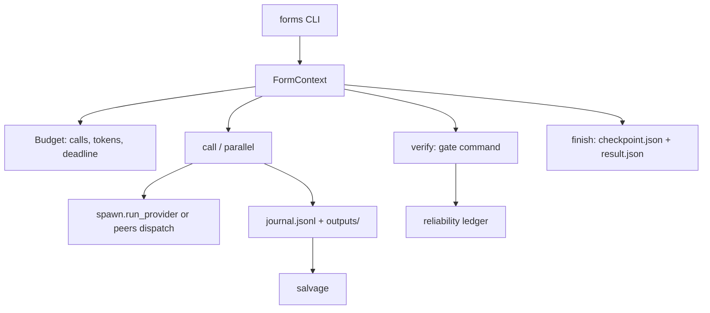

# Runtime forms

The runtime forms are ten Python procedures that dispatch real provider calls under a call, token and time budget. They write an append-only journal, can be cancelled with a process-group kill, and can be recovered after a crash with `salvage`. Read this page to pick a form, run one from the command line, size a wide swarm, or recover an interrupted run.

The forms live in [`python/fusion_swarm/forms/`](../python/fusion_swarm/forms/) and ship with version `3.3.0+swarm`. The command line is `python3 -m fusion_swarm.forms`, and `/fusion:refute`, `/fusion:tournament` and the other form commands tell the host to run it (see [MODES.md](MODES.md)).

## Runtime forms and native team forms are different things

Fusion uses the word "form" for two separate features.

| | Runtime forms (this page) | Native team forms |
| --- | --- | --- |
| Count | 10 (`len(forms.FORMS)`) | 16 (`python3 fusion.py forms --json`) |
| Source | `python/fusion_swarm/forms/` | the TeamSpec runtime, see [CODING_TEAMS.md](CODING_TEAMS.md) |
| Who runs the work | Python dispatches provider CLIs itself and enforces budgets | The host spawns its own native workers; Python only plans and prepares a board |
| Entry point | `python3 -m fusion_swarm.forms` | `python3 fusion.py team\|sidekick\|forms ...` |

Two names appear in both lists: `blackboard` and `map-reduce` / `mapreduce`. The native `blackboard` and `map-reduce` are scheduling shapes for host workers. The runtime `blackboard` and `mapreduce` below are executable code with their own stop rules. They do not share state or code.

Re-check the counts:

```bash
export PYTHONPATH="$PWD/python"
python3 -c "import fusion_swarm.forms as f; print(len(f.FORMS))"
python3 fusion.py forms --json | python3 -c "import sys,json; print(len(json.load(sys.stdin)['forms']))"
```

## Try it offline

Prerequisites: Python 3.10 or newer (the installers enforce this in `install.sh` and `scripts/fusion_install.py`; see [GETTING_STARTED.md](GETTING_STARTED.md)) and `bash` for gate commands. The forms use only the standard library. Nothing on this page needs a provider CLI: examples that dispatch use the fake dispatcher described in [Test without providers](#test-without-providers).

Run everything from the repository root. The commands below were run in a scratch copy with `HOME` and `FUSION_HOME` pointed at a temporary directory.

### List the forms

```bash
export PYTHONPATH="$PWD/python"
python3 -m fusion_swarm.forms list
```

The output is one JSON line: a list of 10 objects with `name`, `summary`, `inputs`, `stop_rule`, `aggregation`, `default_budget` and `available`. A form whose module fails to import is listed with `"available": false` and an `error` string instead of breaking the list ([`forms/__init__.py`](../python/fusion_swarm/forms/__init__.py)).

### Plan without dispatching

`plan` classifies the task text with keyword rules and your flags, then picks a form and a width. It calls no model.

```bash
python3 -m fusion_swarm.forms plan --task "Summarize each of 40 files" \
  --providers a,b --read-only --items 40 --service-s 60 --deadline-s 300
```

Output (one JSON line, reflowed here):

```json
{"form": "mapreduce",
 "params": {"mappers": ["a", "b"], "reducer": "a", "backup_after": 2.0},
 "width": 8,
 "budget": {"max_calls": 46},
 "ladder": ["single"],
 "reasons": ["row 2: decomposable or read-only multi-item -> mapreduce"],
 "capacity": {"width": 8, "captains": 1, "slots_per_captain": 15,
              "expected_makespan_s": 333.92, "dispatch_ceiling_per_min": 14.151},
 "fallbacks": []}
```

`reasons` names the selection-table row that fired. The same task without `--read-only` and without `--isolated` is not fanned out:

```bash
python3 -m fusion_swarm.forms plan --task "Refactor each of 3 modules" \
  --kind decomposable --items 3 --providers a,b
```

The first reason in the result was `row 2 (mapreduce) skipped: write tasks with n_items>1 and no isolation -> single writer + reviewers`, and the form was `single`. Adding `--isolated` gave `mapreduce`.

### Run a form against a fake provider

Create a fixture that maps provider names to ordered replies. Each reply is a string or an object with `output` and optional `delay_s`.

```bash
mkdir -p fx
cat > fx/dry.json <<'EOF'
{"alpha": ["{\"findings\":[{\"file\":\"a.py\",\"symbol\":\"f\",\"issue_class\":\"bug\",\"summary\":\"off by one\",\"evidence\":\"line 3\"}]}", "{\"findings\":[]}", "{\"findings\":[]}"],
 "beta": ["{\"findings\":[{\"file\":\"a.py\",\"symbol\":\"f\",\"issue_class\":\"bug\",\"summary\":\"same\",\"evidence\":\"x\"},{\"file\":\"b.py\",\"symbol\":\"g\",\"issue_class\":\"leak\",\"summary\":\"fd leak\",\"evidence\":\"y\"}]}", "{\"findings\":[]}", "{\"findings\":[]}"]}
EOF
FUSION_TEST_HOOKS=1 FUSION_FORMS_FAKE_DISPATCH=fx/dry.json \
  python3 -m fusion_swarm.forms run dry --task "find bugs" \
  --providers alpha,beta --run-dir runs/dry1 > out.json
echo "exit=$?"
python3 -c "
import json; d = json.load(open('out.json'))
print({k: d[k] for k in ('status', 'stop_reason', 'rounds', 'calls')})
print(d['extra']['coverage_detail'], [f['key'] for f in d['extra']['findings']])"
```

Output:

```text
exit=0
{'status': 'partial', 'stop_reason': 'dry', 'rounds': 3, 'calls': 6}
{'estimate': 2.5, 'observed': 2, 'f1': 1, 'f2': 1, 'completeness': 0.8} ['a.py:f:bug', 'b.py:g:leak']
```

The status is `partial` because no gate command was given, so nothing was verified. Round 0 found two distinct keys, rounds 1 and 2 found nothing new, and two consecutive dry rounds stopped the loop.

### Recover a run

```bash
python3 -m fusion_swarm.forms salvage runs/dry1
```

`salvage` read `runs/dry1/journal.jsonl` and returned `status` `salvaged` (it is `complete` only when the run ended `ok`), `verified: false`, `calls: 6`, `rounds: 3`, `stop_reason: "dry"`, `run_status: "partial"`, and 5 candidates (`f1`, `f2`, `union-r0`, `union-r1`, `union-r2`) with `best` set to the `union` of findings. See [Journal, checkpoint and salvage](#journal-checkpoint-and-salvage).

## Choose a form

`plan` walks this table top to bottom and stops at the first row that matches. It is implemented in [`planner.py`](../python/fusion_swarm/forms/planner.py) (`choose`); the task shape comes from `classify`, where explicit flags always override keyword matching.

| Row | Condition | Form |
| --- | --- | --- |
| 1 | kind `allocation`, or more than one item with heterogeneous task classes | `auction` |
| 2 | kind `decomposable`, or read-only with more than one item | `mapreduce` |
| 3 | kind `discovery` | `loop_until_dry` |
| 4 | kind `estimate` | `delphi` (at least 3 experts, providers repeated if needed) |
| 5 | kind `review` and stakes `high` | `refute_panel` (`k` is 3 when difficulty is `hard`, else 2) |
| 6 | kind `implement`, a verifier, difficulty `hard` | `critic_repair` (fallback entry: `pair_swap`) |
| 7 | kind `implement`, a verifier, latency-sensitive, isolated | `hedged_race` (skipped with a reason when not isolated) |
| 8 | kind `compare` and no verifier | `tournament` |
| 9 | kind `open` and more than one provider | `blackboard` (12 cycles) |
| 10 | anything else | `single` |

Two rules to know:

- **No fan-out of unisolated writes.** Rows 1 and 2 are replaced by `single` when the work writes (not read-only), has more than one item and is not `--isolated`.
- **The ladder is advice.** `plan` returns a `ladder` (`single`, `hedged_race`, `tournament`, `refute_panel` for implement and review kinds; `single`, `delphi` for estimates; `single` otherwise). `planner.next_stage` returns the next stage only after a verifier failure or a disagreement. No command drives that escalation for you, and nothing in the forms records the ledger `stage` role that would make the ladder start higher, so today the ladder is a recommendation you act on.

`classify` keyword rules, the kinds (`implement review discovery estimate decomposable allocation compare open`) and the difficulty, stakes and latency patterns are in `planner.py` lines 25 to 100.

`plan` flags (from `python3 -m fusion_swarm.forms plan --help`): `--task` and `--providers` are required. Optional: `--kind`, `--read-only`, `--verifier`, `--items N`, `--difficulty {easy,medium,hard}`, `--stakes {low,high}`, `--latency`, `--isolated`, `--heterogeneous`, `--service-s` (default 120.0), `--deadline-s`.

## Run a form

```text
python3 -m fusion_swarm.forms run <form> (--task TEXT | --task-file FILE) [--providers a,b,c] [options]
```

`<form>` is a canonical name or an alias (see the table below). `single` is also accepted: it is the planner's one-call stage 0, not one of the ten.

| Form | Aliases | Slash command |
| --- | --- | --- |
| `refute_panel` | `refute`, `refute-panel` | `/fusion:refute` |
| `tournament` | | `/fusion:tournament` |
| `hedged_race` | `hedge`, `race`, `hedged-race` | `/fusion:hedge` |
| `mapreduce` | `map` | `/fusion:mapreduce` |
| `critic_repair` | `critic`, `critic-repair` | `/fusion:critic-repair` |
| `pair_swap` | `pair`, `pair-swap` | `/fusion:pair` |
| `delphi` | | `/fusion:delphi` |
| `auction` | | `/fusion:auction` |
| `loop_until_dry` | `dry`, `loop-until-dry` | `/fusion:dry` |
| `blackboard` | `bb` | `/fusion:blackboard` |

Source: `ALIASES` in `forms/__init__.py` and `RUNTIME_FORM_COMMANDS` in [`modes_catalog.py`](../python/fusion_swarm/modes_catalog.py). Re-check with `python3 -m fusion_swarm.forms run --help`.

### Flags every form accepts

| Flag | Meaning |
| --- | --- |
| `--task`, `--task-file` | The prompt (exactly one is required). A task file must contain text. |
| `--providers a,b` | Comma-separated provider names. Fills each form's roster when you do not set it (see the next table). |
| `--gate-cmd CMD` | A shell command used as the verifier, see [Verification](#verification-and-the-gate-command). |
| `--cwd DIR` | Working directory for provider calls and the gate command. |
| `--budget-calls N` | Call cap. Default depends on the form, see [Budgets](#budgets-and-deadlines). |
| `--budget-tokens N` | Token cap. No default. |
| `--deadline-s S` | Wall-clock deadline in seconds. No default. |
| `--run-dir DIR` | Put the run here instead of under `$FUSION_HOME/forms/runs/`. Must be empty. |
| `--timeout S` | Per-call timeout. Library defaults: 600 for `hedged_race`, 300 for every other form. |

Every form option also has a `--<name>-json` twin that takes a JSON value, for example `--k 2` or `--k-json 2`. Passing both is a usage error. List options take comma-separated values (`--critics a,b`). Options that need structure take JSON only: `--candidates-json`, `--shards-json`, `--roles-json`, `--self-bids-json`.

Where `--providers` fills in the roster:

| Form | From `--providers a,b,c` |
| --- | --- |
| `refute_panel` | `authors` = all (unless `--candidates-json`), `refuters` = all |
| `tournament` | `providers` = all (judges default to the same list) |
| `hedged_race` | `primary` = first, `backups` = the rest |
| `mapreduce` | `mappers` = all, `reducer` = first |
| `critic_repair` | `writer` = first, `critics` = the rest |
| `pair_swap` | `a` = first, `b` = second |
| `delphi` | `experts` = all |
| `auction` | `bidders` = all |
| `loop_until_dry` | `finders` = all |
| `blackboard` | roles resolver, researcher, decider, judge assigned round-robin |
| `single` | `provider` = first |

Source: `_with_provider_defaults` in [`forms/__main__.py`](../python/fusion_swarm/forms/__main__.py).

### Output and exit codes

Every command prints exactly one JSON document on stdout. A run prints the `FormResult`:

| Field | Meaning |
| --- | --- |
| `form`, `run_id` | The form name and the run id (`<form>-<UTC time>-<6 hex>`). |
| `status` | `ok`, `partial`, `failed`, `cancelled` or `budget_exhausted`. |
| `winner` | The selected candidate or `null`. |
| `candidates` | Every candidate the form kept. |
| `rounds`, `stop_reason` | How many rounds ran and why the loop ended. |
| `calls`, `tokens`, `elapsed_s` | Budget usage. `tokens` counts only usage the provider reported. |
| `run_dir` | Where the journal and outputs are. |
| `extra` | Form-specific fields, listed per form below. |

Exit codes:

| Code | When |
| --- | --- |
| 0 | `status` is `ok` or `partial`, and for `list`, `plan`, `salvage`, `ledger`, `capacity` |
| 1 | `status` is `failed` or `budget_exhausted`, or an error such as `verifier_required`, `invalid_input`, `no_providers` |
| 2 | Usage error (bad flag, bad value, non-empty `--run-dir`) |
| 130 | `status` is `cancelled`, including SIGINT or SIGTERM to the CLI (then `stop_reason` is `signal`) |

An error is printed as `{"ok": false, "error": "<code>", "message": "..."}`. Real examples:

```text
$ python3 -m fusion_swarm.forms run critic-repair --task x --writer w --critics c
{"ok": false, "error": "verifier_required", "message": "critic_repair needs a verifier (the critic alone never decides)"}   (exit 1)
$ python3 -m fusion_swarm.forms run delphi --task x --rounds nope
{"ok": false, "error": "usage", "message": "argument --rounds: invalid int value: 'nope'"}   (exit 2)
```

## Shared mechanics

Every form builds one `FormContext` ([`runtime.py`](../python/fusion_swarm/forms/runtime.py)) and makes its provider calls through it.



A form asks the context for a call. The context reserves one unit of budget, dispatches the provider with a timeout clamped to the remaining deadline, saves the output under `outputs/`, and journals `call.start` and `call.end`. Forms then verify candidates, update the ledger from verified outcomes only, and call `finish`, which writes `run.end`, a final checkpoint and `result.json`. `salvage` reads the journal afterwards.

### Dispatch

By default calls go to `spawn.run_provider`, which runs one provider through `fusion.sh dispatch` and kills the whole process group on cancel or timeout ([`spawn.py`](../python/fusion_swarm/spawn.py)). A dispatch result has one of these statuses: `returned`, `timeout`, `absent`, `error`, `cancelled`, `blocked`. Anything else becomes `error`. A call only counts as `ok` when it is `returned`. A provider failure never raises into a form. Provider names, models and the Codex policy are in [PEERS.md](PEERS.md).

`pair_swap` differs: when no dispatch function is supplied and `--use-peers` is true (the default), it dispatches through `peers.exec_json.as_dispatch_fn`, so `a` and `b` may be peer names (`claude`, `codex`, `andrewcode`, `opencode`) routed by the peer policy. That adapter runs with tools `none`, so the exchange is the full solution text.

Up to 8 calls run in parallel by default (`FormContext.max_workers`).

### Budgets and deadlines

`Budget` has three independent limits: `max_calls`, `max_tokens` and `deadline_s`.

- **Calls.** Each call reserves one unit before it starts. When the cap is reached the call is not dispatched, a `budget` record is journaled and the form winds down with `budget_exhausted`. The number of calls is exact.
- **Tokens.** Usage is charged after a call returns, from the provider's `usage` (`total_tokens`, else `input_tokens` plus `output_tokens`). The cap is checked when the next call reserves, so calls already in flight can overshoot it. If a provider reports no usage, nothing is charged.
- **Deadline.** The clock starts when the context is created. A timer cancels the run's token at the deadline even when no call is in flight. Each call's timeout is clamped to the seconds that remain, and the gate command is skipped once the deadline has passed.

Default call caps. These are computed by the CLI when you do not pass `--budget-calls` (`_default_calls` in `forms/__main__.py`):

| Form | Default `--budget-calls` |
| --- | --- |
| `refute_panel` | `2 + 3 * max_k * n`, `n` = candidates, else authors, else refuters (`max_k` default 3) |
| `tournament` | `(0 if --candidates-json else n) + 3 * (n - 1)`, `n` = candidates or providers |
| `hedged_race` | `1 + max_hedges` (3 by default) |
| `mapreduce` | `ceil(shards * 1.1 + 2)` |
| `critic_repair` | `1 + 3 * max_rounds` (10 by default) |
| `pair_swap` | 4 |
| `delphi` | `experts * rounds` (rounds default 3) |
| `auction` | the number of tasks |
| `loop_until_dry` | `max_rounds * (per_round or number of finders)` (max_rounds default 6) |
| `blackboard` | `max_cycles` (12 by default) |
| `single` | 1 |

The `default_budget` values that `list` prints and that the command files quote (for example 17 for `tournament`, 13 for `mapreduce`, 1 for `auction`) are fixed example values for the library, tied to a sample size such as 5 providers or 10 shards. The CLI recomputes the cap from your inputs. The Python `run()` of each form recomputes it too when you do not pass a budget.

### Cancellation

`CancelToken` carries the cancel state. Children are derived per call so a form can cancel one loser without stopping the run. Cancelling kills each registered child's process group: SIGINT, then SIGTERM, then always one SIGKILL of the group (so grandchildren cannot outlive a finished leader). Where available it uses `process_runtime.terminate_process_group`. On Windows it uses `terminate()` then `kill()`. A reused pid is not signalled when the recorded process identity no longer matches.

Cancellation happens when:

- the deadline timer fires,
- a form finishes with losers still running (`hedged_race`, `mapreduce` twins, first-k parallel calls),
- the CLI receives SIGINT or SIGTERM. The handler cancels on a separate thread, the form winds down, and the CLI prints the result with `status` `cancelled`, `stop_reason` `signal` and exits 130.

The mapping of a deadline to a status differs by form. `refute_panel`, `tournament`, `hedged_race` and `mapreduce` report a deadline as `budget_exhausted` with `stop_reason` `deadline`. `loop_until_dry` in the offline run below ended `cancelled`. Check `stop_reason` and `extra`, not only `status`.

### Verification and the gate command

A form's verifier decides what counts as verified. `--gate-cmd` builds a `CommandVerifier`:

- It runs `bash -c "<cmd>"` in its own session, in the candidate's `cwd` or `--cwd`.
- It passes the candidate id and provider in the environment as `FUSION_CANDIDATE_ID` and `FUSION_CANDIDATE_PROVIDER`.
- Exit code 0 is a pass (`score` 1.0), anything else a fail (`score` 0.0). The verdict `kind` is `exec` and `evidence` is the last 4000 characters of the output.
- It times out after 600 seconds or the remaining deadline, whichever is shorter, and a cancelled run kills it.

**The gate command does not receive the candidate's text.** It only sees the id, the provider and the working directory. It is therefore useful when providers edit files in `--cwd` and the gate runs tests there, or when the gate checks something independent of the text. A Python caller can pass any verifier that takes the candidate dict and returns a `Verdict`.

A verdict has `kind` `exec` (a command decided), `llm` (a model or heuristic decided) or `none`. Only `exec` verdicts update the ledger and mark a result `verified`. Which forms use a verifier:

| Form | Verifier |
| --- | --- |
| `critic_repair`, `pair_swap` | Required. `verifier_required` otherwise. |
| `hedged_race` | Required unless `--allow-unverified` (then first reply wins and is never marked verified). |
| `refute_panel` | The empirical gate for candidates with no verified refutation. |
| `tournament` | Execution beats judgment when both candidates have different `exec` verdicts. |
| `auction`, `loop_until_dry` | Optional. Unverified outcomes do not train the ledger. |
| `mapreduce` | Optional, applied to the reduced answer. |
| `delphi`, `blackboard` | Not used, even if you pass `--gate-cmd`. |

### Reliability ledger

[`ledger.py`](../python/fusion_swarm/forms/ledger.py) keeps a Beta posterior per `(worker, task_class, role)`.

- File: `$FUSION_LEDGER_PATH` if set, else `$FUSION_HOME/ledger/reliability.json` (`FUSION_HOME` defaults to `~/.fusion`).
- Schema: `{"version": 1, "cells": [...], "pairs": [...]}`. A cell holds `worker`, `task_class`, `role`, `alpha`, `beta`, `n`, `last_ts`, `latencies` (last 200), `successes`, `failures`. A pair holds `writer`, `reviewer`, `task_class`, `n`, `sum_delta`.
- `record` refuses unverified outcomes (`ValueError("unverified outcome")`). Self-reported confidence is never an input. Before each update `alpha - 1` and `beta - 1` are multiplied by a decay of 0.99.
- Saves merge under an inter-process lock, so two runs do not overwrite each other.
- Selection (`choose`) is Thompson sampling, UCB or mean, with an exploration floor (default probability 0.10, picking among candidates with fewer than 3 samples). It can divide the score by a cost.
- Roles the forms write: `author`, `refuter`, `worker`, `writer`, `critic`, `reviewer`, `finder`, plus `pair` statistics for `pair_swap`. Latency lives on the `(worker, task_class, "*")` cell and needs no verification.

Command line:

```text
forms ledger show [--task-class CLASS]
forms ledger record --worker W --task-class C --role R (--success | --failure) --verified [--latency-s S]
```

For example, `ledger record --worker w --task-class t --role r --success --verified` creates the cell `(w, t, r)` with `n` 1, and `ledger show --task-class t` lists it. `ledger record` requires `--verified`; without it argparse stops with `the following arguments are required: --verified` (exit 2). The flag is your assertion that a real check decided the outcome. Nothing else checks it.

### Capacity sizing

[`capacity.py`](../python/fusion_swarm/forms/capacity.py) sizes a wide swarm with Little's law and a measured captain spawn gap (`SPAWN_GAP_S = 4.24` seconds between spawns). A captain model that spawns one worker per turn can keep about `service_s / 4.24` workers busy, so wide swarms need more captains.

- `width = min(max_width, tasks, ceil(tasks * service_s / deadline_s))` (the last term only with a deadline), at least 1 when there are tasks.
- `captains = min(8, max(1, ceil(width * spawn_gap_s / service_s)))`.
- `expected_makespan_s = width * spawn_gap_s / captains + ceil(tasks / width) * service_s`.
- `slots_per_captain = ceil(service_s / spawn_gap_s)` and `dispatch_ceiling_per_min = captains * 60 / spawn_gap_s`.

```bash
python3 -m fusion_swarm.forms capacity --width 100 --service-s 104
python3 -m fusion_swarm.forms capacity --width 64 --tasks 200 --service-s 90 --deadline-s 600
```

Output:

```json
{"width": 100, "captains": 5, "slots_per_captain": 25, "expected_makespan_s": 188.8, "dispatch_ceiling_per_min": 70.755}
{"width": 30, "captains": 2, "slots_per_captain": 22, "expected_makespan_s": 693.6, "dispatch_ceiling_per_min": 28.302}
```

`--width` is the maximum width and `--service-s` is required. `--tasks` defaults to the width. `--spawn-gap-s` overrides the 4.24 second gap and `--deadline-s` adds the deadline term. Also in the module, used by the forms or available to library callers: `HedgeBudget` (a token bucket that refuses hedges once tokens fall to half), `AIMDLimiter`, `Gradient2Limiter` and `CompositeLimiter` (adaptive concurrency limits), `hedge_delay_s` and `quantile`. The command line uses only `size_width`.

## The ten forms

Each section gives the purpose, the mechanics, the CLI flags beyond the common ones, how it stops, and what is in `extra`. Library keyword arguments that the CLI cannot express (Python callables) are named at the end of each section.

The behavior described here is pinned by [`test_forms_a.py`](../tests/test_forms_a.py), [`test_forms_b.py`](../tests/test_forms_b.py), [`test_forms_c.py`](../tests/test_forms_c.py) and [`test_forms_runtime.py`](../tests/test_forms_runtime.py): those four modules ran 114 tests, all passing, in a scratch copy on 2026-11-22.

### refute_panel

Authors propose answers, cold-start refuters try to kill each one, and an empirical gate decides. Use it for high-stakes review where agreement between models is not evidence.

Mechanics:

1. Round 0: each author writes a candidate independently (no author sees another's output). `--candidates-json` skips this with `[{"id","output","provider"?}]`.
2. Refutation rounds: each surviving candidate gets `k` refuters, preferring a model family different from the author and from each other, ranked by ledger mean for role `refuter`. Each refuter has a lens (from `graph.VERIFY_LENSES`, five lenses, rotated) and must answer with one JSON object `{claim_refuted, evidence_type, reproduction, summary}`.
3. A refutation is **verified** only when `claim_refuted` is true, `evidence_type` is `test` or `trace` and `reproduction` is non-empty (and, in the library, a `reproduce` callable confirms it). Anything else is a **concern** and never kills.
4. If valid votes disagree (a concern next to a non-refuting vote) the panel for that candidate grows from `k` to `max_k`. A candidate with fewer than `k` valid votes is asked for more.
5. Candidates with zero verified refutations go to the gate. With `--gate-cmd`, a pass makes a survivor and a failure makes it `rejected`. Without a gate, the candidate survives with an `llm` verdict and the winner is never `verified`.

Flags: `--authors`, `--refuters`, `--k` (2), `--max-k` (3), `--candidates-json`, `--task-class` (`review`).

Stops: every candidate judged, or budget, deadline or cancel. Winner: the survivor with the best verdict (exec over llm), ties by fewer concerns. `failed` with `no_survivor` when none remain.

`extra`: `survivors`, `killed`, `verified`. Each candidate carries `status` (`killed`, `unjudged`, `rejected`, `survivor`), `verified_refutations`, `concerns`, `refuters`, `verdict`. The journal also records `refutation` records.

Library only: `reproduce(cwd, reproduction) -> Verdict`.

### tournament

A seeded single-elimination bracket over candidates. Use it to rank free-form answers when there is no scalar check.

Mechanics: candidates are shuffled with `random.Random(seed)` (seed defaults to the first 8 hex digits of the SHA-256 of the run id), padded to a power of two with byes for the top seeds, giving `n - 1` matches over `ceil(log2 n)` rounds. Each match, in order:

1. **Execution beats judgment.** If a verifier gives both candidates `exec` verdicts and they differ, the better one wins with no judge call.
2. Otherwise one judge that authored neither candidate (when the judge pool has one) decides in **both orders** (A/B and B/A). If both agree, that candidate wins.
3. If the orders disagree or a vote is unusable, a third judge decides.
4. Last resort: the higher seed.

Flags: `--judges` (default: the providers), `--candidates-json`, `--seed`, `--task-class` (`general`).

Stops: one survivor, or budget, deadline or cancel (the winner is the best survivor of the latest completed round, and an incomplete round is discarded). With a verifier, `exec` verdicts also update the ledger for role `author`.

`extra`: `seed`, `matches`, `bracket` (per match: `a`, `b`, `judge_votes`, `judge`, `winner`, `basis` which is `exec`, `judge`, `judge3` or `seed`), `seeds`, `survivors`, `verified`.

Offline check: a 3-provider run with `--seed 7` finished `ok` / `bracket_complete`, 2 rounds, 9 calls (the cap), with both matches settled by the third judge. The winner was not `verified` because there was no gate.

### hedged_race

The primary provider starts first. After a hedge delay a backup on a different provider starts. The first **verified** answer wins and the others are killed. Use it for latency-sensitive work.

Rules:

- Hedging only runs for idempotent or sandboxed work. Pass `--read-only`, or `--isolation-dirs` with a distinct existing directory per possible attempt. Otherwise: `invalid_input: hedged_race refuses to hedge a writing task`.
- A verifier is required (`--gate-cmd`). `--allow-unverified` degrades to first-OK-wins and the result is never marked verified.
- At most 2 hedges (`--max-hedges 0..2`), each gated by a `HedgeBudget` token bucket (starts full, a hedge costs 1, refused at or below half).
- Hedge delay: `--hedge-delay-s`, else the ledger's p90 latency for the primary clamped to 30 to 600 seconds (needs 20 samples), else 120 seconds.
- At least one backup is required, otherwise `no_providers`. The backup prefers a model family not yet used. It is always a different provider.

Flags: `--primary`, `--backups`, `--hedge-delay-s`, `--max-hedges` (2), `--read-only`, `--isolation-dirs`, `--allow-unverified`, `--task-class` (`general`).

Stops: first verified result (`first_verified`, or `first_ok_unverified` with `--allow-unverified`), every attempt finished or failed (`all_attempts_failed`), or budget, deadline or cancel. If all attempts fail the best partial by verdict score is returned with status `failed`.

`extra`: `attempts` (provider, kind `primary` or `hedge`, status, verified, elapsed), `hedges`, `delay_s`, `hedge_blocked`, `winner_provider`.

Offline check:

```bash
cat > fx/h.json <<'EOF'
{"prim": [{"output":"slow answer","delay_s":30}], "back": ["fast answer"]}
EOF
FUSION_TEST_HOOKS=1 FUSION_FORMS_FAKE_DISPATCH=fx/h.json python3 -m fusion_swarm.forms run hedge \
  --task "summarize" --primary prim --backups back --read-only --hedge-delay-s 0.5 --gate-cmd true \
  --run-dir runs/h
```

The result was `status` `ok`, `stop_reason` `first_verified`, `calls` 2, `extra.hedges` 1. Attempt 0 (`prim`, primary) ended `cancelled` and attempt 1 (`back`, hedge) `returned` and verified.

Library only: `isolate(attempt_index) -> cwd`, a custom `hedge_budget`.

### mapreduce

Deterministic shards go to mappers, stragglers get a backup, and one reducer merges the results while citing shard ids. Use it for independent chunks such as files or documents.

Mechanics:

- Shards are `[{"id","payload"}]` with unique ids (`--shards-json`). The library has `mapreduce.partition(items, n, by="chunk"|"hash")` to build them. The CLI does not call it.
- Shards go round-robin over mappers. Each mapper must reply with `{"shard_id", "facts": [...], "confidence": 0..1}` and the `shard_id` must match, otherwise the result is invalid.
- Backup tasks: once `min_done_for_median` shards (3) are done, a shard whose attempt has run longer than `backup_after` (2.0) times the median duration gets one backup on a different mapper (the same mapper when there is only one). Total backups are capped at `ceil(max_backup_frac * shards)` (fraction 0.10). A failed first attempt also uses a backup. The first valid result per shard wins and its twin is cancelled.
- One reducer sees only shard results, must cite shard ids and list conflicts instead of picking silently: `{"merged", "conflicts": [{"claim","shards"}], "cited": [...]}`. One retry if the reply is not that shape.
- Coverage: every shard must be both mapped and cited. Otherwise the run is `partial` with `extra.missing` or `extra.uncited`. The reducer is never re-run implicitly.

Flags: `--shards-json`, `--mappers`, `--reducer`, `--backup-after`, `--max-backup-frac`, `--min-done-for-median`, `--task-class` (`map`).

Stops: all shards resolved or out of attempts, then one reduce. Status `ok` / `all_shards_reduced`, or `partial` with `coverage_missing`, `reducer_did_not_cite_all_shards` or `verifier_failed`. Status `failed` with `no_shard_results` (no valid mapper reply) or `reduce_failed` (no valid reducer reply after the retry).

`extra`: `missing`, `backups`, `backup_cap`, `shard_results`, `conflicts`, `uncited`, `unknown_cited`.

Offline check (two mappers, one reply each, so the result does not depend on thread timing):

```bash
cat > fx/mr.json <<'EOF'
{"m1": ["{\"shard_id\":\"s1\",\"facts\":[\"x is 1\"],\"confidence\":0.9}"],
 "m2": ["{\"shard_id\":\"s2\",\"facts\":[\"y is 2\"],\"confidence\":0.8}"],
 "red": ["{\"merged\":\"x=1, y=2\",\"conflicts\":[],\"cited\":[\"s1\",\"s2\"]}"]}
EOF
FUSION_TEST_HOOKS=1 FUSION_FORMS_FAKE_DISPATCH=fx/mr.json python3 -m fusion_swarm.forms run mapreduce \
  --task "extract values" --mappers m1,m2 --reducer red \
  --shards-json '[{"id":"s1","payload":"x=1"},{"id":"s2","payload":"y=2"}]'
```

Three runs each gave `status` `ok`, `stop_reason` `all_shards_reduced`, `rounds` 2, `calls` 3, and `winner.cited` `["s1", "s2"]`.

### critic_repair

A writer drafts, an independent critic reviews, the writer repairs, and the verifier (not the critic) decides. Use it for tasks with a real check, such as tests.

Mechanics: round 0 is the writer's draft, verified. Each round the critic (preferring a different family from the writer, rotated across `--critics`) returns `{"issues": [...], "verdict": "ok"|"issues"}`. The writer repairs, and the new version is verified. Every version is kept.

Stop rules, evaluated in this order:

| `stop_reason` | Condition |
| --- | --- |
| `verified_and_critic_ok` | the current version passes the verifier and the critic says `ok` |
| `verified_critic_unavailable` | passes, but the critic gave no parseable verdict |
| `output_repeated` | the repair has the same SHA-256 as an earlier version |
| `regression_reverted` | the repair scores below the best so far (the best is kept) |
| `no_improvement` | no verified improvement for `--patience` rounds |
| `max_rounds` | `--max-rounds` repair rounds done |
| `writer_failed`, `repair_failed` | the writer's draft or repair call failed or returned no text |
| `budget`, `cancelled` | budget or cancel |

A critic call that fails or returns no parseable verdict does not stop the run by itself. A passing version with no critic verdict ends with `verified_critic_unavailable`, and a failing one goes on to the repair step with no listed issues.

Flags: `--writer`, `--critics`, `--max-rounds` (3), `--patience` (2), `--task-class` (`implement`). `--gate-cmd` is required.

Winner: the best version by verdict (exec over llm over none, then pass, then score). The ledger learns only from `exec` verdicts: the writer's first draft, and each critic by whether its round improved the verified score. `status` is `ok` when the winner passed, `failed` otherwise.

`extra`: `verified`, `round_log`, `task_class`, `writer`, `critics`.

Offline check. `fx/gate.sh` fails on its first call and passes from the second (a counter file next to the script):

```bash
cat > fx/gate.sh <<'EOF'
#!/usr/bin/env bash
f="$(dirname "$0")/gate.count"; n=$(cat "$f" 2>/dev/null || echo 0); n=$((n+1)); echo $n > "$f"
echo "gate call $n for $FUSION_CANDIDATE_ID ($FUSION_CANDIDATE_PROVIDER)"; [ "$n" -ge 2 ]
EOF
chmod +x fx/gate.sh
cat > fx/cr.json <<'EOF'
{"writer": ["draft one", "draft two (fixed)"],
 "critic": ["{\"issues\":[{\"summary\":\"missing edge case\",\"evidence\":\"empty input\",\"severity\":\"high\"}],\"verdict\":\"issues\"}", "{\"issues\":[],\"verdict\":\"ok\"}"]}
EOF
FUSION_TEST_HOOKS=1 FUSION_FORMS_FAKE_DISPATCH=fx/cr.json python3 -m fusion_swarm.forms run critic-repair \
  --task "write f" --writer writer --critics critic --gate-cmd "$PWD/fx/gate.sh" --run-dir runs/cr > out.json
python3 -c "
import json; d = json.load(open('out.json'))
print({k: d[k] for k in ('form', 'status', 'stop_reason', 'rounds', 'calls')})
print(d['winner']['id'], d['winner']['verdict'])
print([(c['id'], c['verdict']['passed']) for c in d['candidates']])"
```

Output:

```text
{'form': 'critic_repair', 'status': 'ok', 'stop_reason': 'verified_and_critic_ok', 'rounds': 2, 'calls': 4}
v1 {'passed': True, 'score': 1.0, 'kind': 'exec', 'evidence': 'gate call 2 for v1 (writer)\n'}
[('v0', False), ('v1', True)]
```

Library only: `restore(best)` is called when a regression is reverted so you can roll files back. The CLI does not expose it.

### pair_swap

Two providers pair. One writes, the other reviews and repairs, and the verifier arbitrates. The direction is chosen from the ledger because the benefit is not symmetric.

Mechanics: per direction, the writer drafts (verified, score0), the reviewer returns an improved full solution (verified, score1). The arbiter picks the best version by verdict across everything produced, with ties going to the version with fewer changed lines (`difflib`). `ledger.record_pair(writer, reviewer, task_class, score1 - score0)` is called per executed direction, only when both verdicts are `exec`.

`--direction`:

| Value | Behavior |
| --- | --- |
| `auto` (default) | Pairings whose ledger mean delta is negative after 3 or more samples are skipped. If both are disabled the writer works alone. With two enabled pairings and under 3 samples each, both directions run. Otherwise the higher mean delta runs (a tie runs both). |
| `ab`, `ba` | `a` writes and `b` reviews, or the reverse. |
| `both` | Run both. |

Flags: `--a`, `--b` (must differ), `--direction`, `--use-peers` (true), `--task-class` (`implement`). `--gate-cmd` is required. No loop: each executed direction is write, verify, review, verify.

`extra`: `verified`, `directions` (per-direction `write_status`, `review_status`, `score0`, `score1`, `delta`, `changed_lines`, `recorded`), `selection` (reason and pair stats), `task_class`.

### delphi

Blind expert answers, a code facilitator, revision rounds, then a final answer (plurality or median) plus a dissent log. Use it for estimates and judgment questions where there is no verifier.

Mechanics:

- Round 0 is independent. The prompt holds only the question and the reply schema.
- The facilitator is code, not a model. It builds an anonymous histogram (casefolded, whitespace-collapsed keys). In `--numeric` mode it adds the median and IQR. It shows up to 10 shuffled rationales, capped at 600 characters, with provider and model names and self-references removed. Later rounds see only that summary and the expert's own previous answer.
- `--rounds` counts all rounds including round 0.
- Stop: the histogram is unchanged from the previous round (`stable_histogram`; numeric mode: median moved by at most `--tol` and the IQR did not grow), or the round cap (`rounds_reached`). Consensus is not required. Both end `ok`. If a round has no usable reply the run stops with `no_valid_responses`, keeps the last complete round as the winner (`partial`), or ends `failed` when there is none.
- Final: plurality of the last complete round (ties: higher mean confidence, then lexicographic), or the median in numeric mode. Confidence only breaks ties. An interrupted round is dropped and the last complete round is kept.
- The form writes nothing to the ledger, because an opinion has no verified outcome.

Flags: `--experts` (duplicates allowed as independent samples), `--rounds` (3), `--numeric`, `--tol` (0.0), `--seed`.

`extra`: `final` (answer, estimate, basis `plurality` or `median`), `dissent` (last-round answers that differ, with de-identified rationale), `flips` (answer changes per expert), `histograms`, `numeric`, `seed`. A numeric panel needs a finite `estimate` in each reply. Unusable replies are dropped.

Offline check: three experts, `--numeric --rounds 3` stopped `stable_histogram` after 2 rounds and 6 calls with final answer 12, median basis, IQR 0.0, no dissent, flips `{'e1': 1, 'e2': 1, 'e3': 0}`.

### auction

Awards each task to the bidder the ledger favors. Bids a provider reports about itself never affect the award.

Mechanics: tasks are `[{"id","text","task_class"}]`. For the CLI, pass them as the `--task` text when it starts with `[`; any other text becomes one task `task-1`. For each task the form calls the ledger's `choose` (Thompson sampling, UCB or mean, with exploration floor) for `(task_class, role)`. `--execute true` (default) dispatches each awarded bidder in parallel, one call per task, then verifies. Only `exec` verdicts update the ledger. A call that did not return, an `llm` verdict or a missing verifier train nothing (latency is the one exception).

Flags: `--bidders`, `--method` (`thompson`, `ucb`, `mean`), `--explore` (0.10, within 0 to 1), `--execute`, `--role` (`worker`), `--self-bids-json` (recorded for analysis, `self_bids_used_in_scoring: false`).

Stops: all tasks awarded and executed, or budget or cancel. `--execute false` returns after the award with `stop_reason` `awarded` and no provider calls.

`extra`: `allocation` (`task_id`, `bidder`, `score`, `explored`), `outcomes` (`status`, `verified`, `passed`, `ledger_updated`), `method`, `executed`. Status is `ok` when a verifier exists and every task passed, `partial` otherwise.

Offline check (`--execute false`, `--budget-calls 0`, two tasks, no ledger history, deterministic selection):

```bash
python3 -m fusion_swarm.forms run auction \
  --task '[{"id":"t1","text":"do a","task_class":"fix"},{"id":"t2","text":"do b","task_class":"docs"}]' \
  --bidders w1,w2 --execute false --budget-calls 0 --explore 0 --method mean
```

It returned `status` `ok`, `stop_reason` `awarded`, `calls` 0, and `extra.allocation` of `t1 -> w1` and `t2 -> w1`, each with `score` 0.5 and `explored` false. With no history every bidder has the same posterior mean, so ties keep the first. With the default `--method thompson` the score is a random draw, and the default 10% exploration floor also applies. The CLI does not seed the ledger's random generator, so without `--explore 0 --method mean` the awards can differ between runs.

Library only: `cost(bidder) -> relative cost` and `prompt_fn(task)`.

### loop_until_dry

Keeps sampling finders until several consecutive rounds find nothing new. Use it to hunt for bugs or issues when you want a stopping rule better than "run it three times".

Mechanics:

- A finding is `{"file","symbol","issue_class","summary","evidence"}`. Its canonical key is `file:symbol:issue_class`, casefolded with whitespace collapsed. A seen key is never counted or verified twice.
- Each round asks `per_round` finders, rotating the provider window and the scope (`--scopes`). The prompt lists up to the 200 most recent keys and asks only for new findings, so round 0 carries no other finder's output.
- With a gate, every new finding is verified and only passing findings are kept. Without one, the loop counts new findings and the status is `partial`.
- A round where no finder returned a parseable reply is not informative and does not count as dry.
- Coverage is the Chao1 estimate `observed + f1^2 / (2 * max(f2, 1))`, where `f1` and `f2` are the numbers of kept findings reported by exactly one and two distinct finders.

Flags: `--finders`, `--per-round` (all), `--dry-rounds` (2), `--max-rounds` (6), `--scopes`, `--task-class` (`discovery`).

Stops: `dry` (`--dry-rounds` consecutive informative rounds with no new kept findings), `max_rounds`, `no_valid_responses`, `budget`, `cancelled`. The gate decides `ok`: `dry` is `ok` with a verifier and `partial` without, and every other stop except `cancelled` and `budget` is `partial` (`failed` for `no_valid_responses` when nothing was found).

`extra`: `findings` (with `key` and `found_by`), `coverage`, `coverage_detail`, `rejected`, `dry_streak`, `verified` (true whenever a verifier was configured).

Offline check with a deadline. `fx/slow.json` gives `alpha` a first reply with one finding and a second reply delayed 60 seconds:

```bash
cat > fx/slow.json <<'EOF'
{"alpha": ["{\"findings\":[{\"file\":\"a.py\",\"symbol\":\"f\",\"issue_class\":\"bug\",\"summary\":\"off by one\",\"evidence\":\"line 3\"}]}", {"output":"{\"findings\":[]}","delay_s":60}]}
EOF
FUSION_TEST_HOOKS=1 FUSION_FORMS_FAKE_DISPATCH=fx/slow.json python3 -m fusion_swarm.forms run dry \
  --task "find bugs" --providers alpha --deadline-s 2 --run-dir runs/slow > out_slow.json
echo "exit=$?"
python3 -m fusion_swarm.forms salvage runs/slow
```

The run took about 2.3 seconds and exited 130 with `status` `cancelled`, `stop_reason` `cancelled`, 2 rounds, 2 calls, and the first finding in `winner`. `salvage` then returned `status` `salvaged`, `run_status` `cancelled`, with candidates `f1`, `union-r0`, `union-r1`. The journal ended `call.end` with status `timeout`, `stop` with reason `cancelled`, and `run.end` with status `cancelled`.

### blackboard

Roles write typed entries to a shared board and a deterministic rule table picks which role acts next. Use it for an open question that needs claim, evidence, decision and verdict.

Entries are `{"id","kind","by_role","text","cites"}` with kind `claim`, `evidence`, `question`, `decision` or `verdict`. The run starts with one `question` entry (the task, id `e1`). Rule table, first match activates exactly one role per cycle:

| Rule | Condition | Role (entry it writes) |
| --- | --- | --- |
| 1 | an open question (no claim, evidence or decision cites it) | `resolver` (claim) |
| 2 | a claim with no evidence citing it | `researcher` (evidence) |
| 3 | evidence no decision cites | `decider` (decision) |
| 4 | every claim decided, at least one decision, no current verdict | `judge` (verdict) |
| 5 | nothing matches | stop |

A verdict is current while nothing was added after it, so a late question reopens the board. Entry kinds a role may not write and unknown cite ids are dropped. A resolver, researcher or decider entry that cites none of the rule's targets is linked to the first target. A verdict that cites no evidence is rejected (fail closed). Replies are one JSON object `{"entries": [{"kind","text","cites"}]}`, at most 5 entries per call.

Flags: `--roles-json` (a map of the four roles to a provider or list of providers, ledger-chosen from a list), `--max-cycles` (12), `--channel`.

Stops: `verdict` (a current verdict and no open question), `max_cycles`, `stalled` (the entry-list hash matches an earlier one on two cycles in a row), `no_work`, `budget`, `cancelled`. Only `verdict` is `ok`.

`extra`: `entries`, `activations` (cycle, rule, role, provider, added ids, hash, repeats), `hash`, `latest_decision`, and `mirror` when a port was given.

**`--channel` has no effect from the CLI.** The form mirrors entries into a board thread only when a `BoardPort` object (`port`) is supplied, and the CLI has no flag for it. Mirroring is a library feature (the label `fusion.bb_kind` marks each mirrored entry). See [VBOARD.md](VBOARD.md) for ports.

Offline check, one provider per role:

```bash
cat > fx/bb.json <<'EOF'
{"resolver": ["{\"entries\":[{\"kind\":\"claim\",\"text\":\"Use SQLite\",\"cites\":[\"e1\"]}]}"],
 "researcher": ["{\"entries\":[{\"kind\":\"evidence\",\"text\":\"stdlib, WAL mode\",\"cites\":[\"e2\"]}]}"],
 "decider": ["{\"entries\":[{\"kind\":\"decision\",\"text\":\"Adopt SQLite\",\"cites\":[\"e3\"]}]}"],
 "judge": ["{\"entries\":[{\"kind\":\"verdict\",\"text\":\"SQLite is supported by the evidence\",\"cites\":[\"e3\"]}]}"]}
EOF
FUSION_TEST_HOOKS=1 FUSION_FORMS_FAKE_DISPATCH=fx/bb.json python3 -m fusion_swarm.forms run bb \
  --task "Which store?" \
  --roles-json '{"resolver":"resolver","researcher":"researcher","decider":"decider","judge":"judge"}'
```

The result was `status` `ok`, `stop_reason` `verdict`, `rounds` 4, `calls` 4. The activations were rule 1 to `resolver` (added `e2`), rule 2 to `researcher` (`e3`), rule 3 to `decider` (`e4`), rule 4 to `judge` (`e5`). The winner was `e5`, kind `verdict`, citing `e3`.

### single

`run single` is not one of the ten. It is the planner's stage 0: one dispatch, verified when a gate exists, with `--provider`, `--role` (`writer`) and `--task-class` (`general`). It returns `ok` when the gate passes and `partial` otherwise. Use it as the cheapest first attempt.

## Journal, checkpoint and salvage

Each run owns a directory. With no `--run-dir` it is `$FUSION_HOME/forms/runs/<run_id>` (`FUSION_HOME` defaults to `~/.fusion`; see [CONFIGURATION.md](CONFIGURATION.md)).

| Path | Content |
| --- | --- |
| `journal.jsonl` | One JSON record per line. The source of truth for recovery. |
| `checkpoint.json` | The latest atomic snapshot: status, round, calls, tokens, `best`, `journal_seq`. |
| `outputs/NNNN-<hash>.txt` | Each provider reply, named by call index and a hash of the call key (never the key itself). |
| `result.json` | The final `FormResult`, written by `finish`. |

Source: [`journal.py`](../python/fusion_swarm/forms/journal.py).

### How the journal stays recoverable

- Each record is one `os.write` on an `O_APPEND` descriptor followed by `fsync`, so a crash can tear only the last line. Readers drop a torn or garbage line and the writer terminates a torn final line before appending.
- The checkpoint is written to a unique temp file, synced and renamed, so a reader sees the old or the new one.
- After `run.end` no `call.*` record is written, so a late cancelled call cannot change a finished run.
- `--run-dir` must be empty, which prevents two runs from interleaving in one journal.

Record fields: `seq`, `ts`, `run_id`, `form`, `kind`, then the data. The frozen record kinds are `run.start call.start call.end candidate verdict round hedge cancel ledger budget stop run.end`. The forms also write `lease` (`mapreduce`) and `refutation` (`refute_panel`). A data field named `kind` is stored as `<record kind>_kind`, for example `verdict_kind`, so it cannot overwrite the record kind.

### What `salvage` recovers

`python3 -m fusion_swarm.forms salvage <run-dir>` always replays the journal and never calls a provider. It returns `run_id`, `form`, `status`, `best`, `verified`, `candidates`, `calls`, `rounds`, `stop_reason`, `run_status`.

Recovered:

- **Candidates** from `candidate` records, with their saved output text read from `outputs/` (only paths inside the run directory, at most 1,000,000 characters). When a run has no `candidate` records, successful call outputs become pseudo-candidates.
- **Verdicts** per candidate. The strongest one is kept: exec-passed, then `llm` passed, then `llm` failed, then anything else, then score, then recency. Evidence is capped at 4000 characters.
- **Best**: the highest-ranked candidate by the same order. If `checkpoint.json` exists and its `journal_seq` is at least the last replayed `seq`, its `best` replaces that choice. A stale checkpoint is ignored.
- **Counts**: calls (`call.end` records, or the checkpoint's value if larger), rounds (the larger of the `round` record count and the highest `n`, or the checkpoint's value if larger), `stop_reason`, and the run's final status.

`status` is `complete` only when `run.end` had status `ok`. Every other recoverable run is `salvaged`. A directory with no usable journal or checkpoint, or garbage, gives `status` `empty` and never raises.

`verified` is true only when `best` carries a passing `exec` verdict.

Not recovered:

- A call that had started but never wrote `call.end` has no saved output, so nothing from it is returned.
- Token and cost totals, per-call elapsed time and the form's `extra` fields are not part of the salvage result. Read `result.json` or the journal for those.
- Nothing is resumed. Salvage reports what was recorded. A mapreduce reducer, for example, is not run again.
- The `rounds` value counts journal `round` records, which include round 0 for some forms, so it can be one higher than `rounds` in the run's own result. In the `critic_repair` example above the result said 2 and salvage said 3.

## Test without providers

The CLI replaces provider dispatch with a fixture only when **both** `FUSION_TEST_HOOKS=1` and `FUSION_FORMS_FAKE_DISPATCH=<file>` are set. The file maps a provider name to an ordered list of replies:

- A string reply is returned as the output.
- An object reply is merged into the dispatch result (`output`, `usage`, `model`, and so on). `delay_s` sleeps up to the call timeout and respects cancellation.
- An exhausted list returns an error result (`fixture exhausted`).

Replies are taken from a provider's list in the order calls reach it. When several parallel calls go to the same provider, which call gets which reply can vary between runs. For reproducible examples use one provider per call, as the `mapreduce` and `blackboard` examples above do.

To run the form test modules (a few seconds):

```bash
PYTHONPATH=python python3 -m unittest tests.test_forms_a tests.test_forms_b tests.test_forms_c tests.test_forms_runtime
```

## Known gaps

- The command files for `hedge` say isolated workspaces go through the Python API. The CLI also accepts `--isolation-dirs` for `hedged_race`.
- `delphi` and `blackboard` ignore `--gate-cmd`.
- With `FUSION_ANDREWCODE_SELECTION` set, `adapter.model_family` returns `unverified` for every provider (and a valid selection also puts every known provider into one correlation group), so the "different family" preferences in `refute_panel`, `tournament`, `hedged_race` and `critic_repair` cannot tell providers apart.
- `result.json` and `checkpoint.json` hold your task outputs. Treat a run directory as sensitive.

## Related

- [MODES.md](MODES.md): the slash commands that run these forms.
- [CODING_TEAMS.md](CODING_TEAMS.md): the 16 native team forms.
- [PEERS.md](PEERS.md): providers, models and the dispatch policy behind `--providers`.
- [CONFIGURATION.md](CONFIGURATION.md): `FUSION_HOME`, `FUSION_LEDGER_PATH` and `.fusion/` state.
- [V4.md](V4.md): the 3.3.0 overview.
