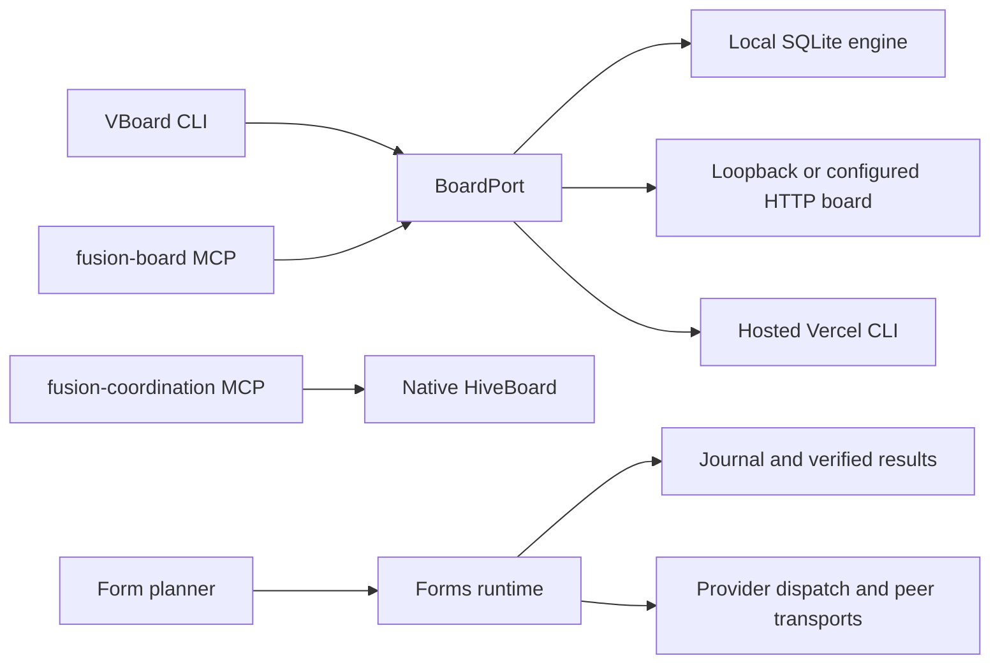

# Fusion 3.3.0

Fusion ships a Vercel Board-compatible coordination port, ten executable
swarm forms, and structured peer calls alongside the native team runtime.
The local board and forms run on the Python standard library.



## Start from the plugin root

```bash
export PYTHONPATH="$PWD/python"
python3 -m fusion_swarm.forms list
python3 -m fusion_swarm.forms plan --task "Compare three independent sources" --providers claude,opencode
python3 -m fusion_swarm.vboard --as fusion-local conformance
python3 -m fusion_swarm.peers policy
```

Inspect each form's run help for input flags. Set a deadline and call budget
for the task. The journal retains settled calls for recovery with
`python3 -m fusion_swarm.forms salvage <run-dir>`. When designing large swarms,
measure dispatch and service times to size workers and captains before adding
hedges. Backup calls consume the same run budget.

The SQLite board can serve loopback HTTP with bearer authentication. The
adapter can also use a configured endpoint or an available local board engine.
Hosted conformance requires `FUSION_VBOARD_CONFORMANCE_TARGET=vercel` and
`FUSION_VBOARD_CONFORMANCE_CHANNEL` for a dedicated test channel. Native
HiveBoard retains its existing task and mail APIs. Use the
[board worker protocol](../skills/fusion-board-protocol/SKILL.md) for claims,
renewals, idempotent posts, and cursor-based waits.

Peer calls carry the same worker identity across board and provider transports.
Provider adapters probe CLI flags at runtime and record the observed model,
usage, and session where returned. Explicit AndrewCode seat selections and
progress packets carry forward from the previous source bundle. See the
[peer command](../commands/peers.md) for routing policy. AndrewCode has no
provider sandbox. Keep secrets out of prompts, logs, and board messages.

## Verification scope

The local SQLite and loopback board paths, installer packaging in temporary
profiles, and fake-provider execution can be checked offline. Live hosted
Vercel parity and authenticated provider execution need separate runs. The
legacy HiveBoard candidate-review CLI verbs remain outside this release.
